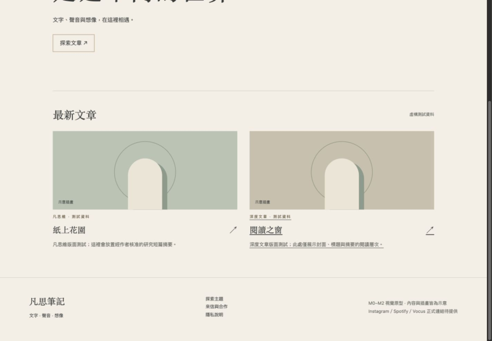
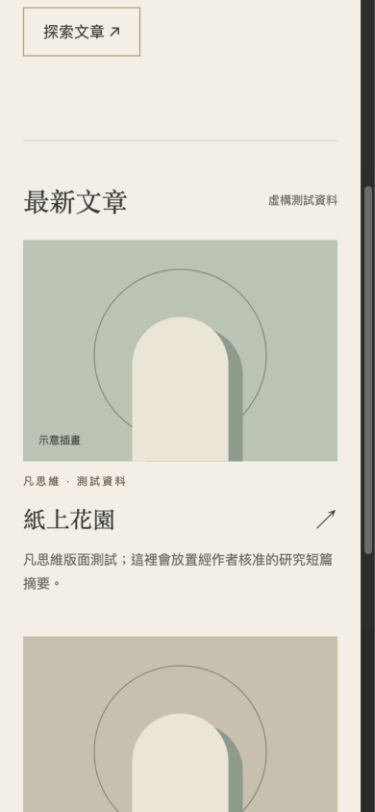

# M0／M1 驗收紀錄

2026-11-12（Asia/Taipei）。對應 docs/01、03、04、05、06；配色依 docs/02 暫定。

Astro 7.4.11、Node 24.22.3、TypeScript 6.0.3。`npm run check`：0 errors／warnings／hints；`npm run build`：13 頁；`npm test`：4/4 通過。npm audit：0 vulnerabilities。TypeScript 7 尚不符合 Astro check peer dependency，因此採相容的 6.0.3。

本機預覽 `http://localhost:4321/fansi-notes/`，非公開部署。已檢視 1440×1000 與 390×844 響應式畫面；手機以常駐搜尋與展開選單導覽。所有生成頁面的本機 href/src/action 驗證 base 與目的地存在。鍵盤與動態的完整互動驗收於 M2 紀錄。

新增內容目錄僅兩篇明確標記的 synthetic 測試文字；未讀取或匯入私人文章、音檔、Canva 素材。既有規格文件保持不變。CI 僅建置與保存 artifact，不含部署、RSS 排程與寫入權限。

尚未提供：作者署名、真實圖像與內容、社群網址、留言與聯絡提供者。此階段留空；不提供假播放器、收件或出版資料。完整搜尋／同步及正式閱讀模板於 M3。

回退：關閉本 PR 即可；未合併或部署。
