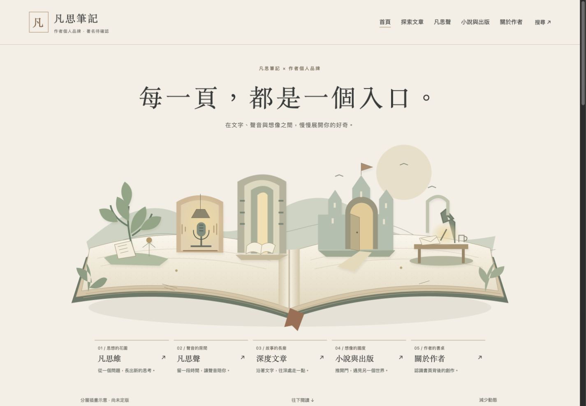
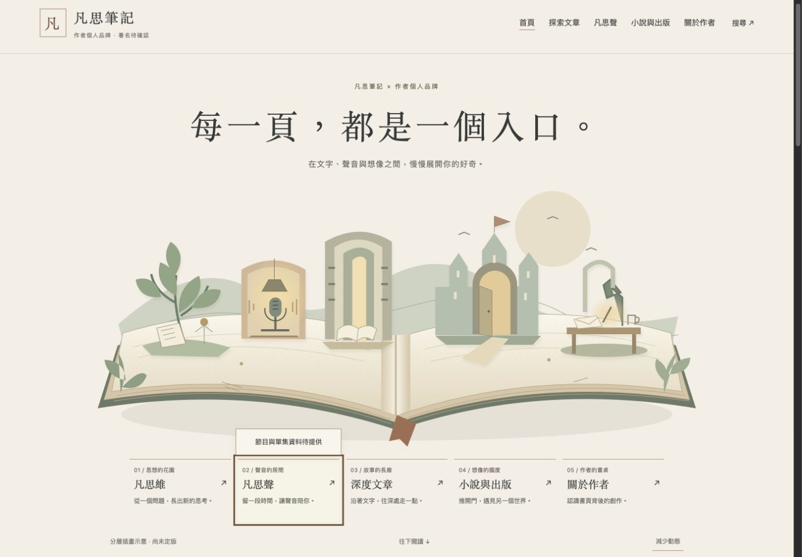

# M2 故事書首頁驗收

日期：2026-11-12（Asia/Taipei）。範圍對應 docs/01、02、03、05、06；接續 M0／M1 PR #1，不進入 M3–M5。

## 實作

首頁以同一張展開的書為基底，SVG 拆為遠景、書頁、五場景與前景。思想花園、聲音房間、故事長廊、想像國度、作者書桌各有辨識物件，HTML 入口文字獨立於插畫。提供低幅度 pointer 視差、hover／focus 預覽、單一局部回應、鍵盤 Enter 與手機單次點擊。沒有自動音效、強制捲動、WebGL 或第三方素材。

SVG 是本次原創程式繪製的占位插畫（6,098 bytes），並非作者核准定稿。可替換 `src/assets/storybook.svg` 的獨立 `data-layer`／`data-scene` 圖層，保留 HTML 入口。暖紙白、鼠尾草綠與青銅色皆是暫定 token。正式署名、Logo、主圖、文章及書籍內容等待作者確認。

下方接續測試文章、主題、精選空狀態、凡思聲、出版書架示意、作者與來信入口。沒有將虛構資料宣稱為正式作品；未匯入任何未發表原稿。

## 驗證結果

- Node 24.22.3／Astro 7.4.11／TypeScript 6.0.3；`npm run check`：0 errors、0 warnings、0 hints。
- `npm run build`：13 頁；`npm test`：7/7 通過。路由、Pages base、內部資產、合成資料範圍、無部署權限、動態偏好／觸控／每幀更新、無 JS 靜態入口皆有測試。
- 實際瀏覽器：macOS 上 ChatGPT 內建瀏覽器。1440×1000 桌機、768×1024 平板、390×844 手機、320×740 窄版；document scrollWidth 均未超過 viewport。
- 五場景逐一以 Enter 開啟正確頁面並能返回；Tab 順序依次為 garden、sound、corridor、kingdom、desk，每個都有 solid 焦點外框。結果保存在 `m2/navigation.json` 與 `m2/focus.json`。
- Focus 預覽 opacity=1；滑鼠移動會更新視差變數；按「減少動態」後 px=0px，全部 8 個圖層 computed transform 為 none。截圖為手動開關狀態。
- 手機五入口高度約 102.7px，預覽文字常駐；單次點「凡思維」進入 1 篇篩選結果。搜尋無結果顯示 0 篇與清除提示，清除後恢復 2 篇。手機選單可展開並進入小說與出版。
- 瀏覽器檢查期間未見 console error/warn。系統 `prefers-reduced-motion` 初始、動態變更與優先權以單元測試驗證；未更動使用者 OS 設定。無 JS 備援驗證建置 HTML，未執行瀏覽器停用 JS 模式。
- 未執行 Lighthouse，不能宣稱已達 performance 80／accessibility 90 的正式門檻；真實手機觸控、螢幕閱讀器與跨瀏覽器仍需後續 QA。當前截圖與窄版測試是桌面瀏覽器 viewport 驗證。

## 畫面

## 預覽與部署邊界

依 README 的 `npm ci`、`npm run dev -- --host 127.0.0.1` 啟動後開啟 http://localhost:4321/fansi-notes/。只在本機預覽。CI 保存 dist artifact，不包含 Pages 部署或 RSS 排程；所有頁面禁止索引。沒有正式網站公開、沒有合併 PR、沒有修改其他 Repository。

回退方式：關閉 M2 PR；已合併時可 revert M2 commit 回 M1。M2 PR 以 M1 分支為 base，審閱順序為 #1 再 M2；M1 合併後請將 M2 base 改為 main。

完成後停止。下一步等待作者確認：首頁整體美術、景深幅度、五場景排列、手機入口與字級。M3 內容同步／正式模板、M4 作品世界、M5 留言與公開部署均尚未開始。
