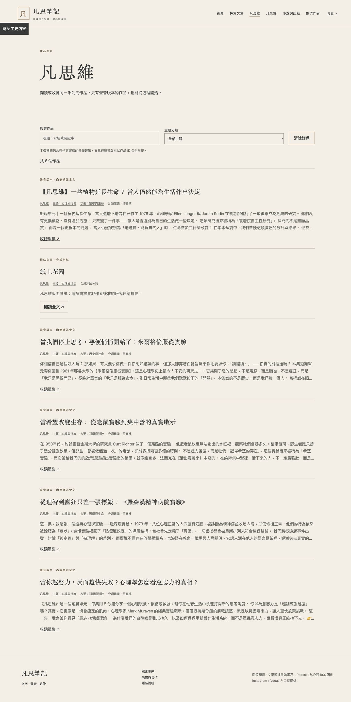
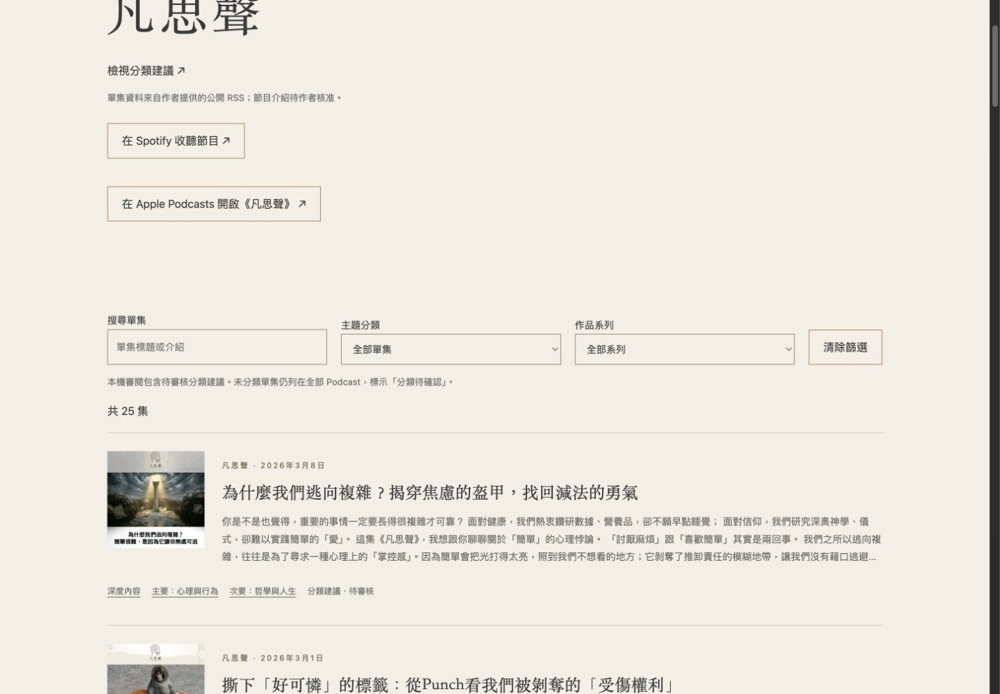
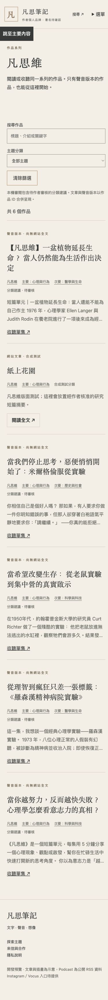
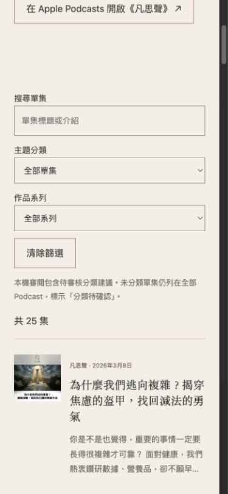

# M3 分類補強驗收

範圍：三個作品系列、九大主題、主要／次要主題上限、自由關鍵字、GUID 人工分類、跨媒介作品去重。小說出版與 M4 未修改，未合併或部署。

初始 25 集分類：凡思維 5、深度內容 17、特別篇 3，全部 proposed。查看 `/review/classifications/`；核准作者與時間尚未填入，不能把建議視為核准。

## 驗證

- Astro check：0 errors、0 warnings、0 hints；建置 50 頁。
- 24 項測試通過：主要必填／次要至多一個／不重複、未知分類拒絕、未核准不誤配、Podcast-only、未分類照常顯示、分類來源優先順序、按作品 ID 去重、RSS 更新保留既有連結與人工資料。
- 三次隔離 Astro 建置：新增文章、改名稱／類型／主題／平台連結與核准配對、只修改字典新增主題與重新命名，確認主題頁、系列頁、文章及單集分類一起更新。
- 桌機 1440×1000：凡思維系列 6 個作品（5 個聲音作品＋1 篇合成文章）；選科學與科技剩 2 個。
- Podcast 桌機與手機：凡思維＋醫學與生命剩 2 集；清除篩選恢復 25 集。
- 手機 390×844：scrollWidth 375，不超過 viewport；表單鍵盤 Tab 可到清除篩選，主題與系列可操作。既有 reduced-motion 與無 JS 回歸通過。
- 無 JS 初始 HTML 依系列／主題正確隱藏非符合項；前端清除可展開全部作品。
- 本機開發伺服器因模型熱更新的舊快取曾回傳 ZodError，重啟後正常；正式建置及整合測試正常。

分類與作品關聯不依標題相似度；原 25 集 Spotify／Apple 直達資料未變更。只改兩篇既有合成文章的分類，未修改正文；無未公開原文或私稿。

## 上線前隔離補強（2026-11-13）

本節取代前述 50 頁／24 項測試的舊結果。審閱頁移至 src/review，由 Astro dev 專用 integration 註冊；build／preview／sync 均不註冊。本機仍可看 25 筆 proposed，正式建置不輸出其系列、主題或關鍵字。

- Astro check：0 errors、0 warnings、0 hints；正式建置 49 頁；27 項測試全部通過。
- 整合測試先放入過期審閱 HTML，再建置並確認檔案已清除；遞迴掃描 HTML、JS、JSON、XML、TXT，不含審閱路徑、入口、建議標記與 proposed 搜尋哨兵字串。
- 驗證安全預設排除 proposed、confirmed 保留、原始分類檔未改、work_id 穩定，25 集單集頁均存在。
- HTTP：本機 dev 審閱頁 200；正式 build 的本機 preview 審閱頁 404，Podcast 頁 200。
- 瀏覽器確認正式 Podcast 顯示「共 25 集」、「分類待確認」，無審閱入口。截圖如下。
- 25 筆建議與既有雙平台單集連結均未修改。此處排除的是網站產物；GitHub 原始資料依要求保留。

## 固定系列頁驗收

凡思維、深度內容、特別篇只輸出所屬作品，不顯示系列選單；清除篩選仍限制原系列。閱讀入口加強，Podcast-only 標示聲音版本；凡思聲保留完整系列／主題／搜尋。

27 項測試通過，check 零錯誤，build 49 頁。瀏覽器桌機 1440、手機 390 驗證：凡思維醫學篩選 2 個、清除 6 個，搜尋植物 1 個；凡思聲凡思維＋醫學 2 集、清除 25 集、搜尋植物 1 集。手機 scrollWidth 375，無水平溢出。截圖為本機 proposed 審閱模式，未核准分類不會因此公開。

