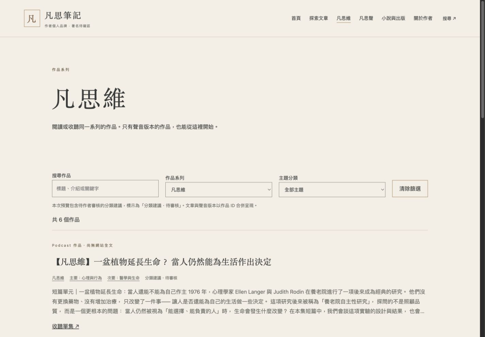
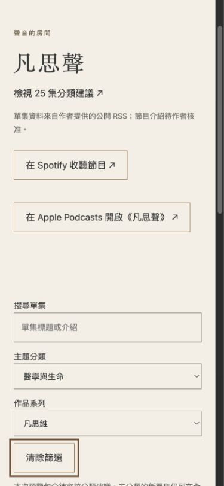

# M3 分類補強驗收

範圍：三個作品系列、九大主題、主要／次要主題上限、自由關鍵字、GUID 人工分類、跨媒介作品去重。小說出版與 M4 未修改，未合併或部署。

初始 25 集分類：凡思維 5、深度內容 17、特別篇 3，全部 proposed。查看 `/review/classifications/`；核准作者與時間尚未填入，不能把建議視為核准。

## 驗證

- Astro check：0 errors、0 warnings、0 hints；建置 50 頁。
- 24 項測試通過：主要必填／次要至多一個／不重複、未知分類拒絕、未核准不誤配、Podcast-only、未分類照常顯示、分類來源優先順序、按作品 ID 去重、RSS 更新保留既有連結與人工資料。
- 三次隔離 Astro 建置：新增文章、改名稱／類型／主題／平台連結與核准配對、只修改字典新增主題與重新命名，確認主題頁、系列頁、文章及單集分類一起更新。
- 桌機 1440×1000：凡思維系列 6 個作品（5 個聲音作品＋1 篇合成文章）；選科學與科技剩 2 個。
- Podcast 桌機與手機：凡思維＋醫學與生命剩 2 集；清除篩選恢復 25 集。
- 手機 390×844：scrollWidth 375，不超過 viewport；表單鍵盤 Tab 可到清除篩選，主題與系列可操作。既有 reduced-motion 與無 JS 回歸通過。
- 無 JS 初始 HTML 依系列／主題正確隱藏非符合項；前端清除可展開全部作品。
- 本機開發伺服器因模型熱更新的舊快取曾回傳 ZodError，重啟後正常；正式建置及整合測試正常。

分類與作品關聯不依標題相似度；原 25 集 Spotify／Apple 直達資料未變更。只改兩篇既有合成文章的分類，未修改正文；無未公開原文或私稿。

