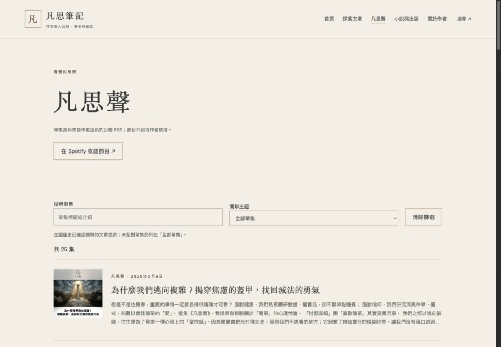
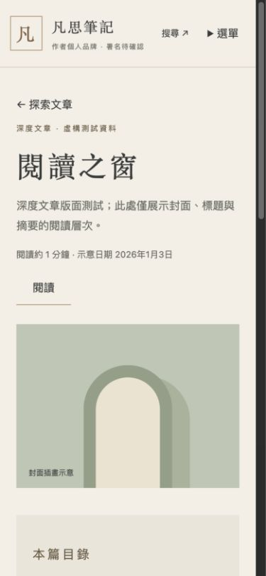
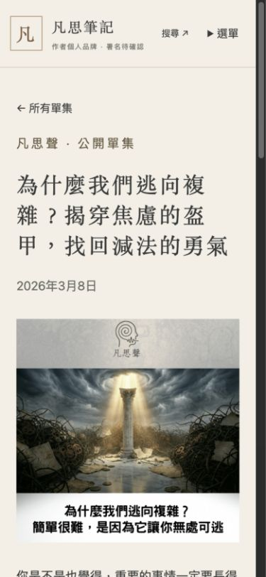

# M3 驗收紀錄

對照 docs/04_內容模型與每週同步.md、docs/06_開發里程碑與驗收.md。

- Astro check：0 errors、0 warnings、0 hints；靜態建置 39 頁。
- Node 測試：19/19 通過。包含新增、改名與舊網址、分類／標籤、平台補鏈、GUID 異名配對的兩次真實隔離建置；RSS 重試／逾時／失敗保留、危險 XML 與 URL 拒絕、M2 動態與無 JS 回歸。
- 桌機 1440×1000：Podcast 25 集；輸入「減法」後剩 1 集。
- 文章正文搜尋「章節示意」＋閱讀主題＋最早優先，正確剩 1 篇。
- 手機 390×844：長文目錄與封面、Podcast 標題封面日期可閱讀；scrollWidth 375，不超過 viewport 390。單集封面 naturalWidth 3000，初始 iframe 數量 0。
- 鍵盤 Tab 可到跳至主要內容；既有 reduced-motion／手動關閉／觸控不啟動測試通過。播放器以合成有效格式 URL 驗證條件顯示及初始無 iframe，尚無正式單集 URL 可做真人播放驗收。
- 圖片皆為實際瀏覽器截圖；文章與插畫為合成示意；Podcast 為作者明確授權的公開 RSS 展示資料，無未發表原文。
- PR 不含部署步驟。排程因自動審核拒絕持久寫入權限，採唯讀 artifact；預設分支合併後才啟用。

