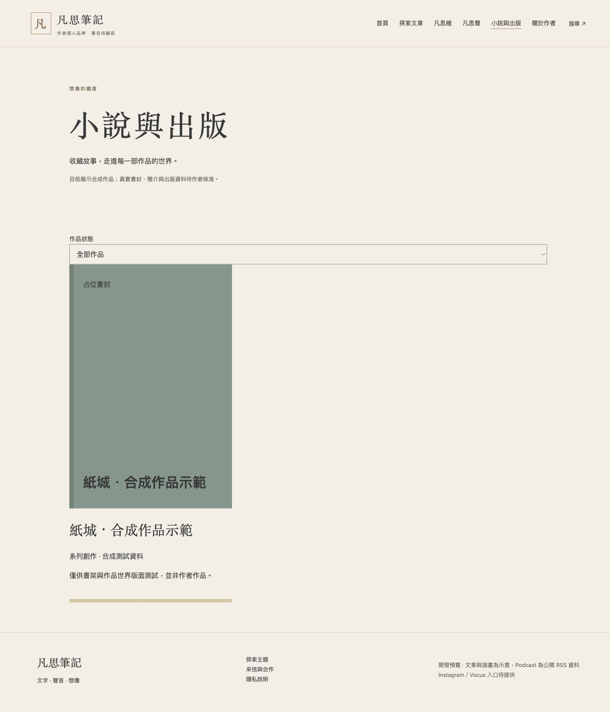
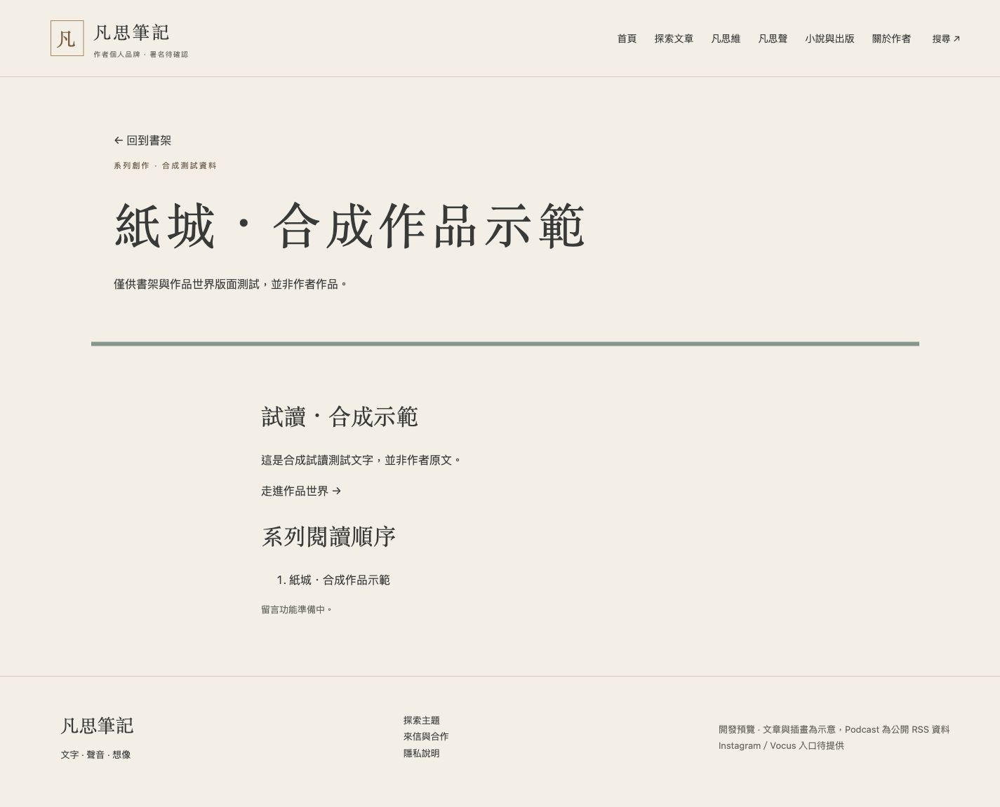
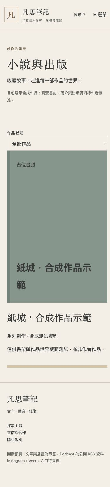
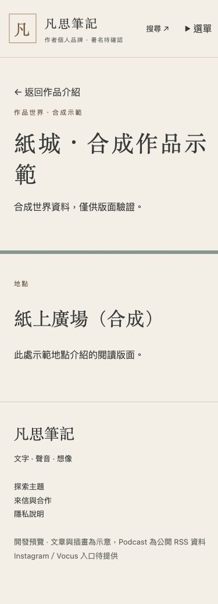
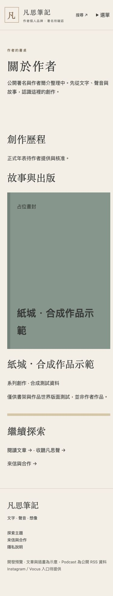

# M4 書架與作者頁驗收

依 03 頁面規格、06 M4 開發。僅合成作品，真實書封、購書連結、作者簡介及年表尚未提供；不補造。M3 的 25 集仍 proposed，正式建置排除 proposed，本機待審核展示不變。空分類補上尚無已確認作品說明。

出版資料集中 src/data/publications.json：永久 work_id、slug、publication_kind（published／short／series）、summary、核准者與版本、synthetic；可選 cover（HTTPS）、publisher、year、author、series／order、excerpt、links。只有作者核准可公開內容才可寫入此公開 Repository，不能存私人草稿再靠網站隱藏。world 必須 approved:true 且有 intro、entries 才生成路由。人物／地點／事件／番外均由作者提供。

修改一筆作品後首頁、書架與作者頁自動更新；作品詳頁顯示試讀、系列順序與已提供的外連。作者資料在 author.json，未核准時必須保留空值；核准後才能填 name、bio、photo、timeline。ChatGPT SOP 不會自行寫入 GitHub，仍須授權後由工具提交。

桌機 1440、手機 390 實際驗證：書架分類空狀態、作品詳頁、世界入口及返回、作者頁正常。手機世界頁 scrollWidth375，無水平溢出。書架支援 focus，reduced-motion 關閉抽出效果；無 JS 仍顯示所有書籍與正常連結。

不合併、不部署、不進 M5。回退此 M4 PR 即可回到 M3。
