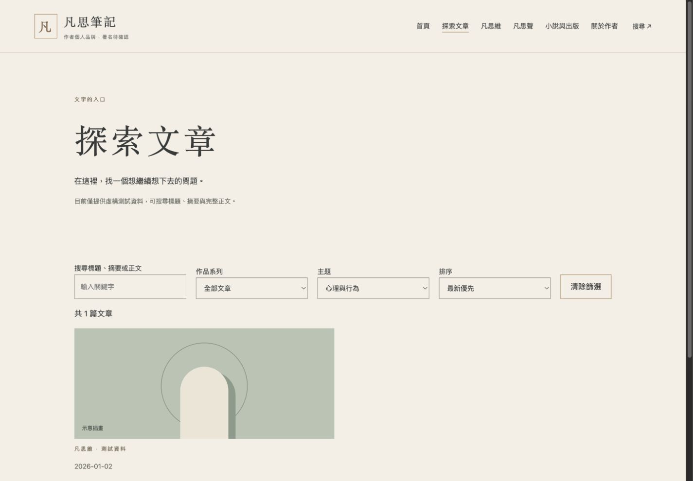
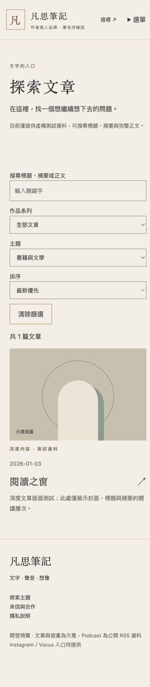
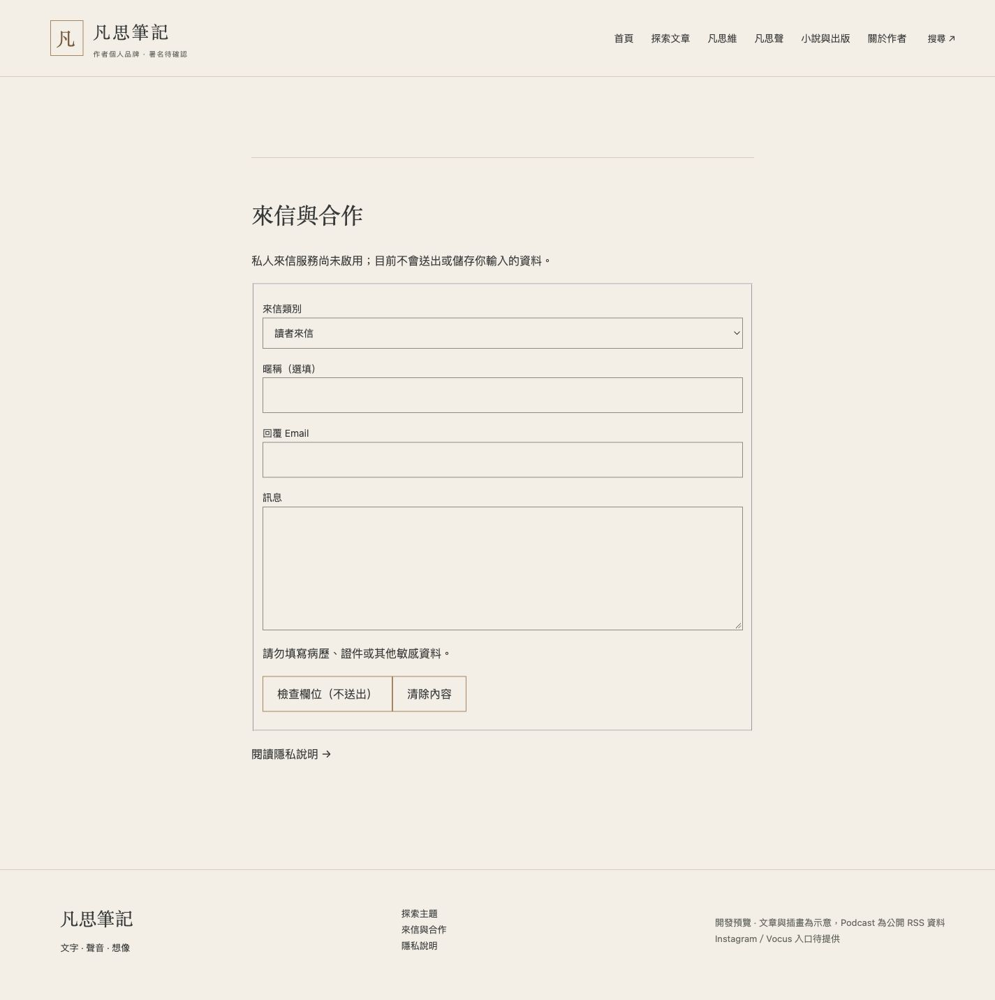
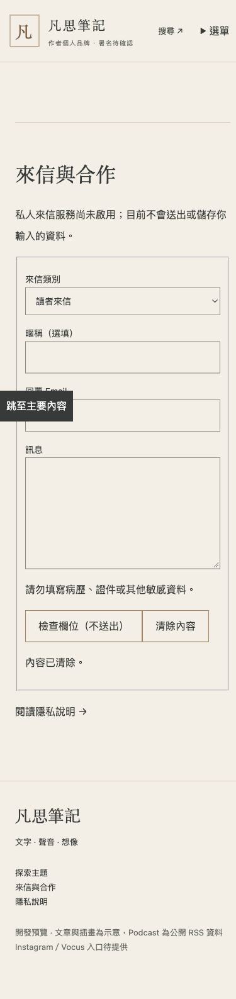
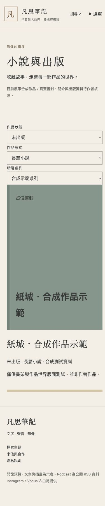

# M5-A 驗收

基底 PR #5／M4 fd9f431，獨立分支 codex/m5a-readiness。沒有重新開發首頁或創作 SOP；只在歷史文件加有效階段標示，安全規則不變。

## 驗證結果

- Astro check 0 errors／warnings／hints；build 51 頁，另有 sitemap.xml 與 feed.xml；33 tests 全通過。
- 搜尋：心理主題 1 篇、醫學 0 篇、清除恢復 2 篇；正文「章節示意」1 篇。手機 literature 1 篇。結果為合成文章。
- 正文只預處理一次，查詢防抖120ms，中文組字中暫停搜尋，Enter／結束組字立即處理；下拉選單 change 即時更新。排序僅變更時重新排序 DOM。
- Node 本機純篩選基準：1000 筆約數千字合成全文、20 次查詢共13ms；不是手機端到端或 Lighthouse 分數，不推論大型資料的 DOM 效能。
- 小說三軸：未出版＋短篇無結果，改長篇＋合成系列恢復1筆，形式不再混作出版狀態。
- 聯絡：合成 Email／訊息格式檢查、清除、沒有網路送出；無JS時fieldset停用，沒有submit按鈕；尚未啟用服務，不能驗收真實送達。
- 桌機1440、手機390；手機文章／聯絡 scrollWidth375，無水平溢出。截圖附下。既有鍵盤、無JS及 reduced-motion 回歸仍通過。
- RSS 回歸涵蓋超時、HTTP500重試、錯誤XML、安全URL、保留快取及人工平台連結。25集分類及GUID配對原樣保留。
- 匯入兩種合成記錄、原子暫存、拒絕未授權、重複ID、路徑穿越、覆寫；dry-run不寫檔。正式資料需M5-B授權，不會自行寫入Repo。
- sitemap／文章RSS排除合成作品與審閱；canonical及OG使用Pages base；noindex／robots保持阻擋。沒有部署job或第三方寫入。

## 尚未執行（M5-B）

真實稿件整合、真實平台送達／審核／作者回覆、服務逾時與垃圾訊息端對端測試、正式網域及公開部署、Lighthouse正式站評分。詳見 CURRENT_STATE 與服務準備文件。

最後內容範圍驗收：34 tests 通過、check 零錯誤／警告／提示、build 51 頁。新增 website-original 與短篇全文獨立核准驗證；詳見 docs/M5A_最後驗收與交接.md。沒有新增真實作品或核准 Podcast 分類。
