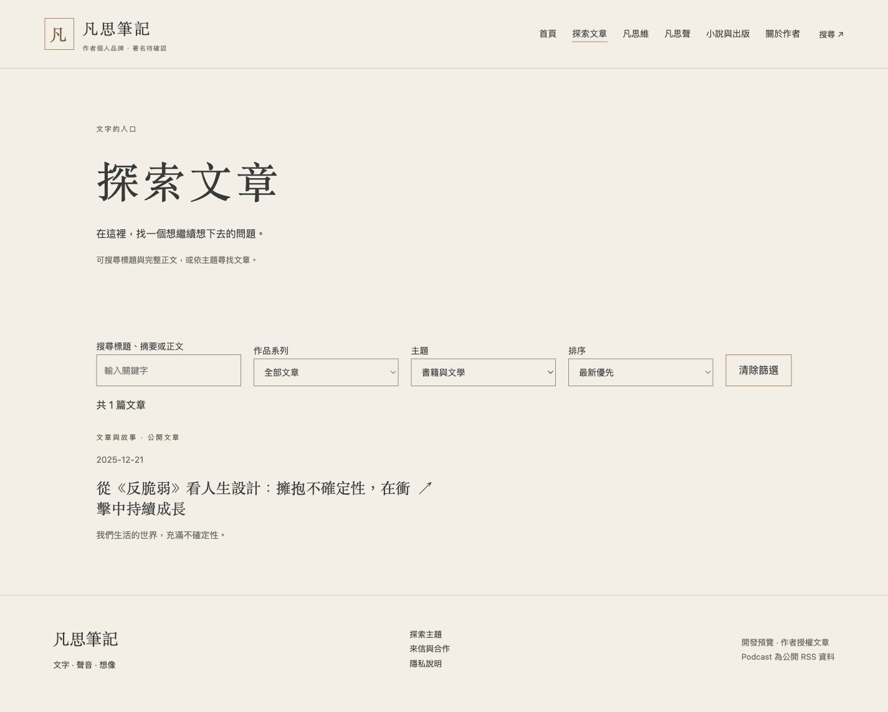
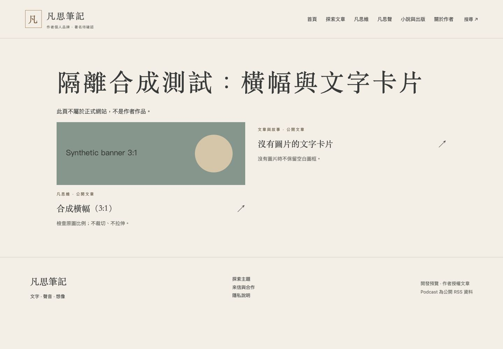
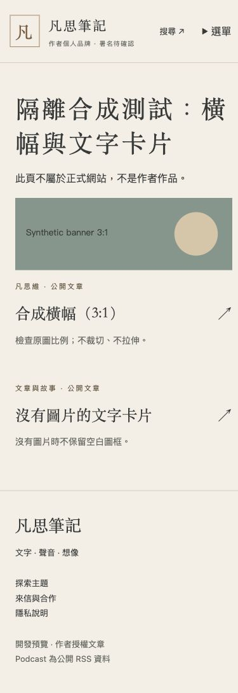

# M5-B 技術修正與批次匯入阻擋紀錄

從 PR #8 merge commit `14fd8e6c1d0b6b32aa10a66f504cbc180ce0056b` 建立 `codex/m5b-vocus-history`。本輪沒有完成新增歷史文章匯入，不能將來源核對當成匯入成功。

## 實際結果

- 新匯入 **0篇**；網站正式文章仍為 **3篇**；其餘 **45篇** 因缺少已核准網站系列／主次題跳過。
- 既有48筆來源均重新確認公開頁可讀、Vocus ID與凡思筆記署名一致。讀取成功不等於已通過完整格式轉換、分類或所有重刊權利核對。
- 本機清冊的 content_type／primary_topic／secondary_topic 皆空白；下載交接包只有25集 proposed，明示尚未核准。沒有將Podcast建議或Vocus房間推定為網站分類。
- 11筆原文精確單集連結可與既有平台ID對應，涉及10個GUID，其中兩篇指向同一單集；只保留候選，正式映射仍空白。未找到直接IG單篇外連，新增IG為0。
- Repository外的 `m5b-inventory/本輪集中待確認.md` 列出45篇來源及分類缺口、11筆精確GUID候選；`vocus-batch-preflight.json` 保存本輪來源ID、版本日期、文字雜湊及圖片來源位置。沒有將未完成核准的全文提交公開Repository。
- 三篇已匯入文章檔案與main逐位元一致；重新取得Vocus正文，空白正規化後SHA256與原核准記錄三篇皆一致。對照見 [驗證JSON](existing-source-verification.json)。

## 程式修正

WorkCard使用既有cover_image／cover_alt，首頁與列表共用，width:100%、height:auto保持原比例。無圖片保留文字卡片，沒有加入正式圖片。首頁五場景、文章版型及文末平台按鈕不變。

舊ID集中於taxonomy.json：history_society→society、books→literature、personal→creation。資料驗證時正規化，搜尋查詢也相容；舊主題路由轉至現有標準網址。九主題、文章分類及正式路由不變；未知ID、正規化後重複主次題仍被拒絕。

## 驗證

- `npm run check`：67檔案，0 errors／warnings／hints。
- `npm run build`：53頁（原50頁＋3條舊主題轉址）。
- `npm test`：44/44通過；含三次隔離整合建置、首頁／列表／系列封面、分類別名、舊路由、搜尋、拒絕覆寫既有ID及未分類匯入。
- 桌機1440及手機390：舊query books／personal正確選主題與1篇結果；清除後可搜尋「蘿蔔」，命中1篇。
- 3:1隔離合成封面：桌機540×180、手機327×109，比例保持，無水平溢出；旁邊無圖片卡片無空白圖框。測試頁及圖片只在Repository外，不進正式網站。

| 檢查 | 桌機 | 手機 |
|---|---|---|
| 真實文章列表／舊ID篩選 |  |  |
| 隔離合成封面／文字卡片 |  |  |

## 真正需要作者確認

提供已在ChatGPT確認的45篇分類結果或該檔案位置（Vocus ID、系列、主要主題、選填次要主題）；現有可讀本機資料沒有這份核准結果。沒有要求重做已完成的分類討論，也不需要再次提供Vocus來源。

Podcast候選可另外核准，不是文章匯入的必要條件。圖片本輪不授權、不下載；獲得分類後，逐篇辨識abstract來源，保留原文及圖說並完成轉換與完整性比對，來源／權利不清者繼續跳過。

不合併、不部署、不啟用服務、不進入其他階段。
