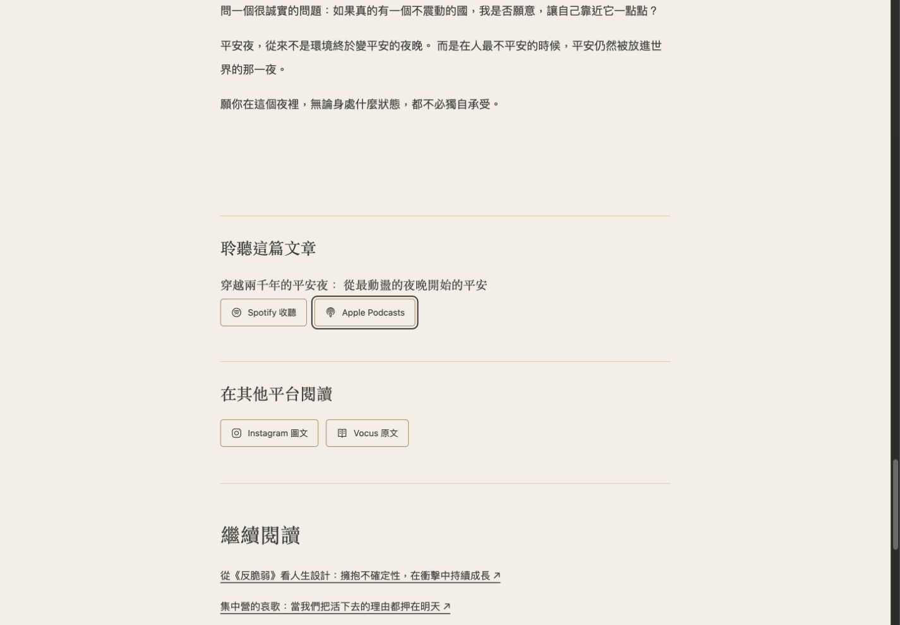
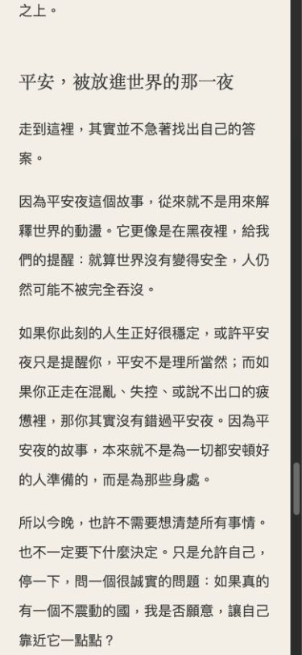
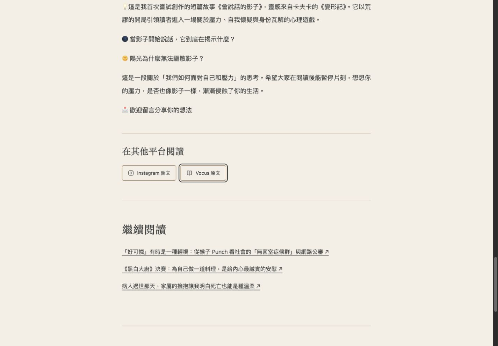
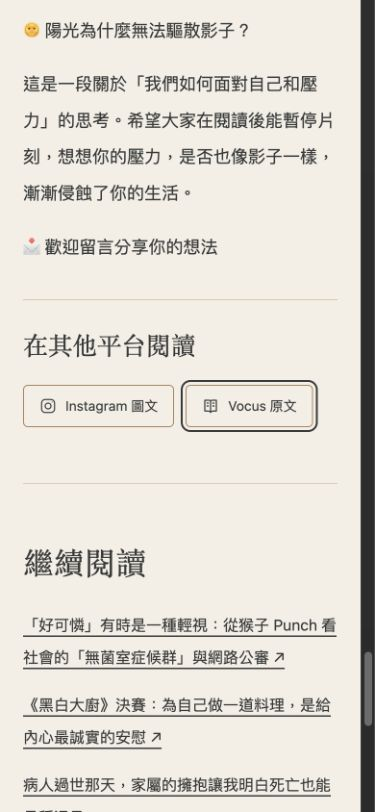
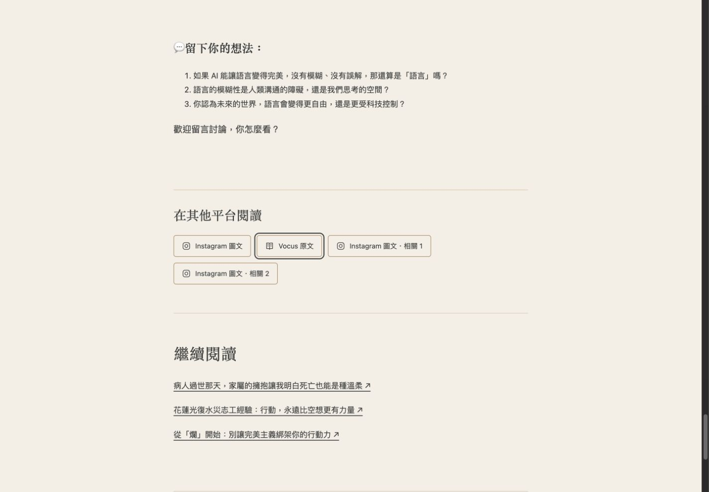
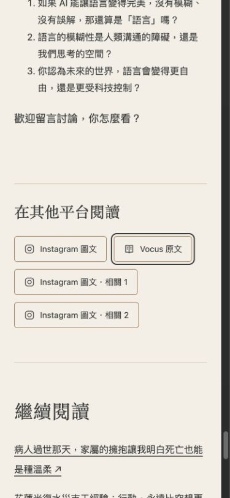
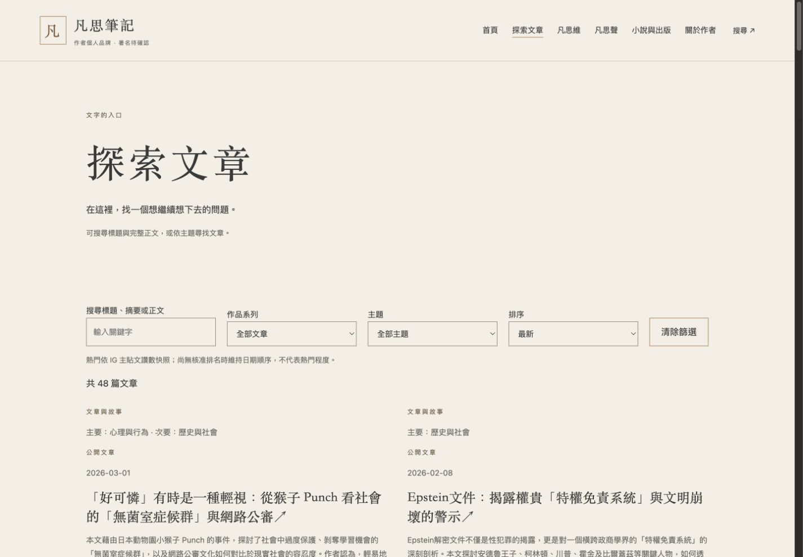
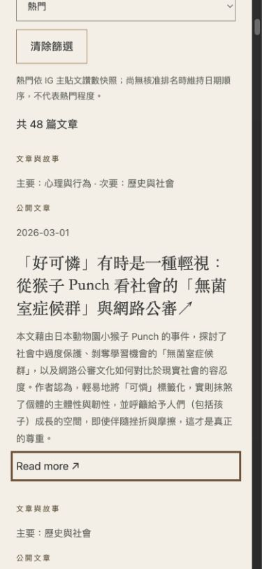
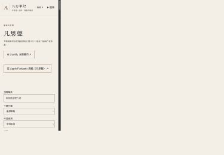

# PR #11 最新驗收：正式資料接線與文章文末

2026-11-15。接續既有 PR #11，沒有新 PR，沒有變更 PR #10 或 main。下方初次驗收保留為歷史，不代表目前資料仍空。

## 真正完成
- 48個work_id逐筆核對：47個IG主貼文、同一作品額外2個IG貼文；47個文章人氣順位、25個RSS GUID人氣順位。來源是作者交付PUBLIC JSON，完整檔與SHA256附於inputs/及data-import.json，沒有重新爬取IG或RSS。
- 《抹除文字的鋼筆》IG／順位未知，保持null（前台不渲染缺漏按鈕），不編造日期、讚數或播放數。所有精確快照日期null；排名不是原始數值。
- Podcast人氣口徑只有發布後首7天播放與下載總數。文章社群人氣使用主貼文讚數順位，不加總多貼文。熱門已實測接線，未知在最後，首頁最新四篇不變。
- 四個原文spotifycreators短網址：HTTP轉址的單集ID與既有RSS episode URL ID一致，使用該單集已存Spotify及Apple網址。證據在src/data/listening-redirects.json。沒有按標題比對、沒有新增GUID映射，也沒有Podcast反向文章連結。
- 共用ArticlePlatforms／PlatformLinks／PlatformButton呈現有效媒介；四種按鈕44px，同樣圖示細框。主IG與兩則相關IG明確區分；同來源CTA呈現層去重，原文宣傳字句及來源位置隱藏保留，研究引文不變。
- 原文、原有分類、圖片標記及非平台metadata與本輪前逐檔完全一致。

## 驗證與界線
16項針對性測試通過：全48篇IG接線／無重複／無漏值、25 GUID順位、未知／同分／錯誤口徑、四短網址正規化與去重、原文完整性。Astro check 0 errors/warnings/hints；build98頁。GitHub全套CI見PR checks。
實際瀏覽器1440×1000、390×844：
1. 平安夜文章：有來源可驗證的Podcast外連，四平台按鈕齊全且每個網址只顯示一次。
2. 《會說話的影子》：只有IG／Vocus，整個收聽區塊不渲染。
3. 《禁語之地》：主IG＋兩則相關IG＋Vocus，無重複網址、無空白框、手機自然換行。
按鈕為真實HTTPS外連，逐筆與作者交接資料或既有已核實單集URL一致；本輪不重新登入或爬取IG。
正式GUID映射目前為空，因此沒有可宣稱「已正式配對」的真實文章。上述聲音案例是原文證據外連；核准映射分支由現有隔離測試驗證，不以假配對填入正式資料。

## 尚待項目（非本輪已完成）
- M5-C：封面／內文圖素材、用途與重刊權核准；M5-D後續依原始位置正式接圖。沒有下載圖片、使用Canva或用IG輪播文字圖卡取代正文。
- 正式work_id↔GUID映射與25集Podcast proposed分類仍待作者核准。
- 沒有改書架、服務或部署設定。未合併、未部署。

## 最新文章文末截圖

---

# 歷史：M5-D 初次共用介面驗收（以下為資料接線前狀態）

基底：PR #9 未合併，HEAD `dec2e8cad58dec85913966504a47036aabb9a8bd`。本分支只新增共用介面功能，不重匯正文或分類。

## 完成
- WorkCard 上方系列與主次主題；封面、標題與 Read more 分別連結。48 篇摘要在連結外，可選取複製；無封面不產生空白連結。
- 文章與 Podcast 的最新、最早、熱門排序；已知排名在未知之前，同排名按發布日期由新到舊，日期相同以固定識別碼穩定排序。首頁最新四篇邏輯未改。
- IG 人氣採主貼文讚數快照，Podcast 採發布後首7天播放與下載總數。兩種 metric 分開驗證，不接受 Spotify-only 或跨口徑資料。
- 沿用 PlatformButton 統一四平台圖示細框；新增可選 related_instagram_urls，排除完全重複網址，缺少平台不渲染空框。
- 原文獨立 Podcast 宣傳段落及圖說，只在呈現層將可識別單集網址合併文末；原位置、文字與網址保留為隱藏來源。一般研究引文維持原樣，不建立 GUID 關聯。
- 保留原有圖片位置與插入機制、Podcast-only、48 篇分類與正文；沒有圖片下載、書架或服務修改。

## 資料接收契約與本輪界線
`src/data/popularity.json` 目前是空的 articles/podcast 陣列，未加入合成排名。
每筆接受 `id`（文章 work_id／Podcast GUID）、`rank`（正整數或 null，可同名次）、`snapshot_at`（ISO 日期時間或 null）、`metric`。
文章 metric 為 `instagram_primary_post_likes`；Podcast 為 `first_7_days_plays_plus_downloads`。重複 ID、負數、零、小數排名、無效日期、錯誤口徑均阻擋建置。
未提供精確快照日期時保留 null，絕不使用匯入日期冒充快照時間。排名不是原始讚數或播放數，不展示推算數值。

附件的公開交接 JSON 已檢查結構，但依本輪「先完成可接收資料的元件與驗證」要求，尚未正式匯入：47 篇 IG 對應（其中一篇多貼文）、25 集人氣排名。後續將 work_id/guid 對應到 id、popularity_rank 對應到 rank，填入正確 metric；IG primary_instagram_url 寫入既有 platform_urls.instagram_url，相關貼文放 related_instagram_urls。只按固定 ID 核對，缺漏不猜測。
尚未能識別目的單集的短網址保留原有可點連結，不解析猜測、不升格為正式關聯。已核准的圖片與作者摘要仍待另輪匯入。

## 驗證
- Astro check：70 檔，0 errors／warnings／hints。
- production build：98 頁。
- 受影響測試：13/13 通過，涵蓋人氣未知／同排名／日期、口徑與資料驗證、48 篇原文雜湊及分類入口、平台去重與研究引文保留。
- 真實瀏覽器：1440×1000 與 390×844；文章48篇、Podcast25集。最新／最早切換結果正確；空人氣資料熱門回退日期且顯示說明。手機無水平溢出，摘要不在 anchor 內。
- GitHub CI 狀態以 PR 檢查結果為準。

## 實際畫面

未合併、未部署、未啟用服務。
