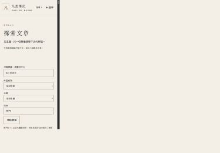
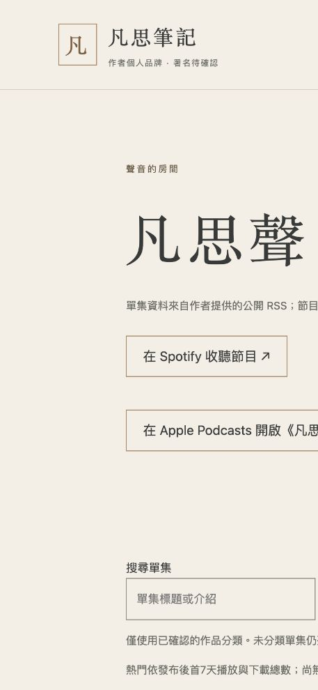

# M5-D 共用介面與排序驗收（2026-11-15）

基底：PR #9 未合併，HEAD `dec2e8cad58dec85913966504a47036aabb9a8bd`。本分支只新增共用介面功能，不重匯正文或分類。

## 完成
- WorkCard 上方系列與主次主題；封面、標題與 Read more 分別連結。48 篇摘要在連結外，可選取複製；無封面不產生空白連結。
- 文章與 Podcast 的最新、最早、熱門排序；已知排名在未知之前，同排名按發布日期由新到舊，日期相同以固定識別碼穩定排序。首頁最新四篇邏輯未改。
- IG 人氣採主貼文讚數快照，Podcast 採發布後首7天播放與下載總數。兩種 metric 分開驗證，不接受 Spotify-only 或跨口徑資料。
- 沿用 PlatformButton 統一四平台圖示細框；新增可選 related_instagram_urls，排除完全重複網址，缺少平台不渲染空框。
- 原文獨立 Podcast 宣傳段落及圖說，只在呈現層將可識別單集網址合併文末；原位置、文字與網址保留為隱藏來源。一般研究引文維持原樣，不建立 GUID 關聯。
- 保留原有圖片位置與插入機制、Podcast-only、48 篇分類與正文；沒有圖片下載、書架或服務修改。

## 資料接收契約與本輪界線
`src/data/popularity.json` 目前是空的 articles/podcast 陣列，未加入合成排名。
每筆接受 `id`（文章 work_id／Podcast GUID）、`rank`（正整數或 null，可同名次）、`snapshot_at`（ISO 日期時間或 null）、`metric`。
文章 metric 為 `instagram_primary_post_likes`；Podcast 為 `first_7_days_plays_plus_downloads`。重複 ID、負數、零、小數排名、無效日期、錯誤口徑均阻擋建置。
未提供精確快照日期時保留 null，絕不使用匯入日期冒充快照時間。排名不是原始讚數或播放數，不展示推算數值。

附件的公開交接 JSON 已檢查結構，但依本輪「先完成可接收資料的元件與驗證」要求，尚未正式匯入：47 篇 IG 對應（其中一篇多貼文）、25 集人氣排名。後續將 work_id/guid 對應到 id、popularity_rank 對應到 rank，填入正確 metric；IG primary_instagram_url 寫入既有 platform_urls.instagram_url，相關貼文放 related_instagram_urls。只按固定 ID 核對，缺漏不猜測。
尚未能識別目的單集的短網址保留原有可點連結，不解析猜測、不升格為正式關聯。已核准的圖片與作者摘要仍待另輪匯入。

## 驗證
- Astro check：70 檔，0 errors／warnings／hints。
- production build：98 頁。
- 受影響測試：13/13 通過，涵蓋人氣未知／同排名／日期、口徑與資料驗證、48 篇原文雜湊及分類入口、平台去重與研究引文保留。
- 真實瀏覽器：1440×1000 與 390×844；文章48篇、Podcast25集。最新／最早切換結果正確；空人氣資料熱門回退日期且顯示說明。手機無水平溢出，摘要不在 anchor 內。
- GitHub CI 狀態以 PR 檢查結果為準。

## 實際畫面

未合併、未部署、未啟用服務。
