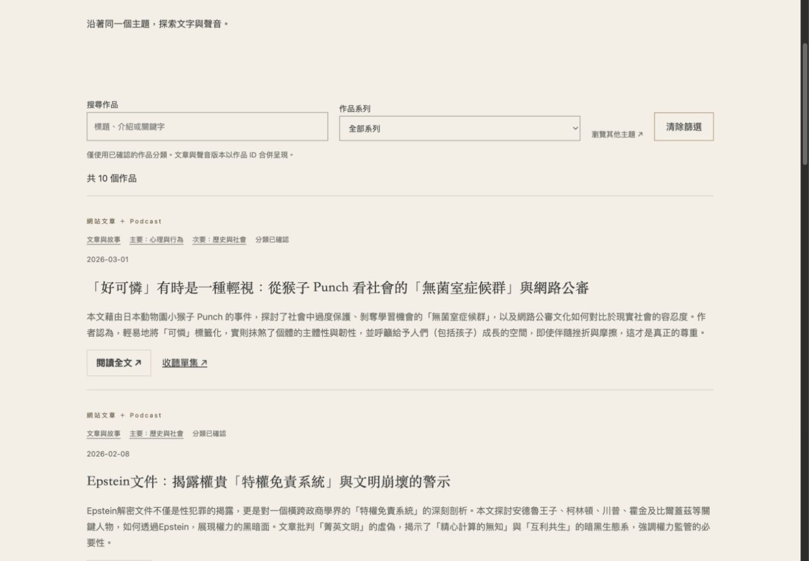
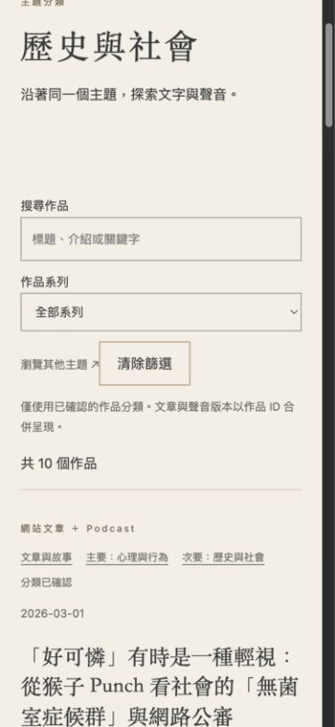
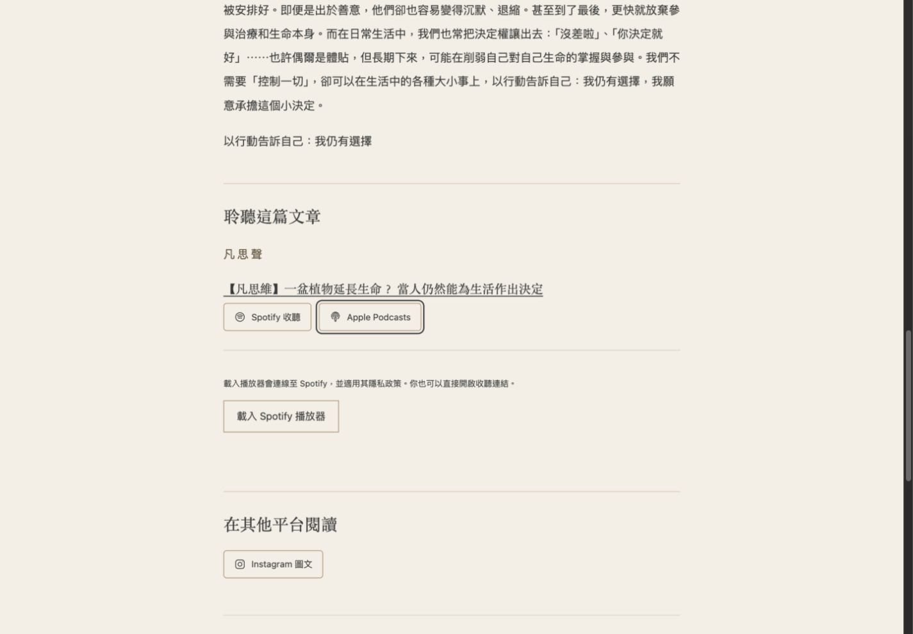
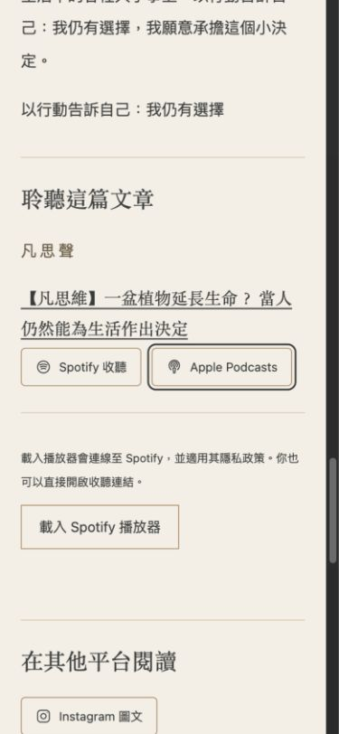
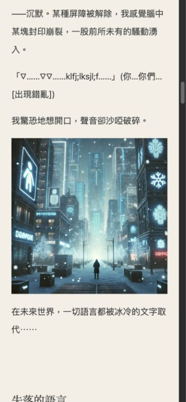

# PR #19 M5-D 最終工程驗收

## 已實作／測試通過，待作者驗收
沿用 PR #19 的57篇正文、25集、25組映射及既定視覺。沒有任何正文、分類、IG/Vocus網址、人氣資料或既有16組映射變更。
- ArticleBrowser 在凡思維使用 catalog().works 對應的 UnifiedWorkCard；仍是8篇正式凡思維，閱讀與音訊同一張卡。文章／文章與故事維持雙欄（57／49篇），主題單欄，統一作品共57筆。WorkCard增加實際配對單集入口。標題／封面／閱讀入口可點，摘要仍在連結外。
- UnifiedWorkCard補齊日期、標題連結及有核准封面時的原比例顯示；沒有更動首頁、導覽、全站色彩與字型。
- 原文圖片位置在呈現層接入：11張來自《禁語之地》《謊言垃圾場》與尼采／耶穌敘事的原清冊插圖，原始位置與圖說保留。全部URL HEAD為200且image類型，代表圖GET與瀏覽器實際載入成功。使用no-referrer避免來源頁造成載入失敗，錯誤時隱藏圖片、不留下破圖框；不下載圖檔至repo。
- 151筆中其餘140筆省略：15張Podcast宣傳，其餘125張不明來源、第三方／人物照片或未選用素材。原三篇8個缺來源位置與新九篇維持無圖。未另行素材搜尋，沒有拿IG文字圖卡替代全文，也沒有指定不適合的封面。

## 六項舊失敗修正
1. content-build：已核准文章映射優先於獨立分類proposed，fixture應呈現confirmed；仍保留獨立未配對proposed不能公開的測試。新增植物書面版本可在凡思維找到。
2–3. m5b-import：全站改57／映射25，兩系列8／49；原3+45篇來源全文雜湊與路由驗證保留。
4. m5c-podcast-approved：以正式57篇資料驗證25組唯一GUID與有效work_id；另以原main的16組快照逐筆深度相等保護。鬼滅兩篇獨立文章與唯一正式映射測試未刪除。
5–6. m5d-data：舊48篇IG網址仍逐筆核對，人氣改以核准的新順位快照比對；映射25。新增全批基線驗證56個IG順位／1 null、Podcast原25排名不變。
新增 m5d-final 測試：57篇檔案SHA256完整不變、49Vocus／56IG、25集雙平台與反向入口、原16映射不變、buildWorks結果57而非82、11圖按指定位置插入。

## 結果
- npm run check：74 files，0 errors／warnings／hints。
- npm run build：107頁。
- npm test：61/61通過。GitHub CI另見PR checks。
- 實際瀏覽器1440×1000／390×844：凡思維8篇；搜尋「植物」1篇；文章57篇最新／最早／熱門；Podcast25集熱門；社會主題清除篩選留在原URL且維持10個作品。雙欄計算540px+540px；手機scrollWidth375小於390，無水平溢出。
- 新IG書面文章的Spotify／Apple／IG入口正確、Vocus缺省；播放器仍選擇載入。主題統一作品卡同時閱讀與收聽；圖片在原段落間，保留原圖說。原文與分類不動，不對內容改寫。
- 57篇與25集的每個建置頁、平台URL與25組映射均由批次測試核對，不以少數截圖代替完整數據驗證。

## 已知例外與停止範圍
遠端圖片有供應端可用性風險，已實作失敗收合；未採用圖片不阻擋文字閱讀。沒有正式封面時保持無圖。精確人氣快照時間仍null，不造即時數字。作者尚未驗收，不自行標記已驗收；未合併／部署／啟用服務，不進M5-E。

## 實際截圖

