# PR #19 M5-D 最終工程驗收

> 最新結果在下方「最後一批」；前批紀錄保留，圖片已由11張擴充為96張，測試由61項增加為64項。

## 前批驗收（105d145；以下11張圖片及61項測試為歷史基線）
沿用 PR #19 的57篇正文、25集、25組映射及既定視覺。沒有任何正文、分類、IG/Vocus網址、人氣資料或既有16組映射變更。
- ArticleBrowser 在凡思維使用 catalog().works 對應的 UnifiedWorkCard；仍是8篇正式凡思維，閱讀與音訊同一張卡。文章／文章與故事維持雙欄（57／49篇），主題單欄，統一作品共57筆。WorkCard增加實際配對單集入口。標題／封面／閱讀入口可點，摘要仍在連結外。
- UnifiedWorkCard補齊日期、標題連結及有核准封面時的原比例顯示；沒有更動首頁、導覽、全站色彩與字型。
- 原文圖片位置在呈現層接入：11張來自《禁語之地》《謊言垃圾場》與尼采／耶穌敘事的原清冊插圖，原始位置與圖說保留。全部URL HEAD為200且image類型，代表圖GET與瀏覽器實際載入成功。使用no-referrer避免來源頁造成載入失敗，錯誤時隱藏圖片、不留下破圖框；不下載圖檔至repo。
- 151筆中其餘140筆省略：15張Podcast宣傳，其餘125張不明來源、第三方／人物照片或未選用素材。原三篇8個缺來源位置與新九篇維持無圖。未另行素材搜尋，沒有拿IG文字圖卡替代全文，也沒有指定不適合的封面。

## 六項舊失敗修正
1. content-build：已核准文章映射優先於獨立分類proposed，fixture應呈現confirmed；仍保留獨立未配對proposed不能公開的測試。新增植物書面版本可在凡思維找到。
2–3. m5b-import：全站改57／映射25，兩系列8／49；原3+45篇來源全文雜湊與路由驗證保留。
4. m5c-podcast-approved：以正式57篇資料驗證25組唯一GUID與有效work_id；另以原main的16組快照逐筆深度相等保護。鬼滅兩篇獨立文章與唯一正式映射測試未刪除。
5–6. m5d-data：舊48篇IG網址仍逐筆核對，人氣改以核准的新順位快照比對；映射25。新增全批基線驗證56個IG順位／1 null、Podcast原25排名不變。
新增 m5d-final 測試：57篇檔案SHA256完整不變、49Vocus／56IG、25集雙平台與反向入口、原16映射不變、buildWorks結果57而非82、11圖按指定位置插入。

## 結果
- npm run check：74 files，0 errors／warnings／hints。
- npm run build：107頁。
- npm test：61/61通過。GitHub CI另見PR checks。
- 實際瀏覽器1440×1000／390×844：凡思維8篇；搜尋「植物」1篇；文章57篇最新／最早／熱門；Podcast25集熱門；社會主題清除篩選留在原URL且維持10個作品。雙欄計算540px+540px；手機scrollWidth375小於390，無水平溢出。
- 新IG書面文章的Spotify／Apple／IG入口正確、Vocus缺省；播放器仍選擇載入。主題統一作品卡同時閱讀與收聽；圖片在原段落間，保留原圖說。原文與分類不動，不對內容改寫。
- 57篇與25集的每個建置頁、平台URL與25組映射均由批次測試核對，不以少數截圖代替完整數據驗證。

## 已知例外與停止範圍
遠端圖片有供應端可用性風險，已實作失敗收合；未採用圖片不阻擋文字閱讀。沒有正式封面時保持無圖。精確人氣快照時間仍null，不造即時數字。作者尚未驗收，不自行標記已驗收；未合併／部署／啟用服務，不進M5-E。

## 實際截圖

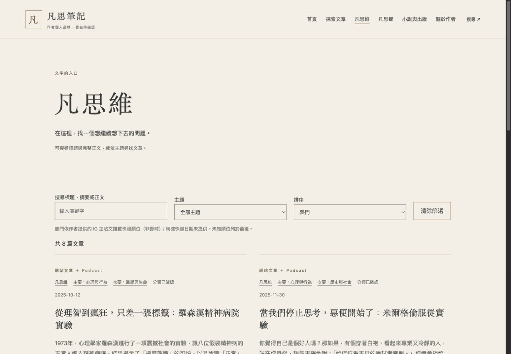

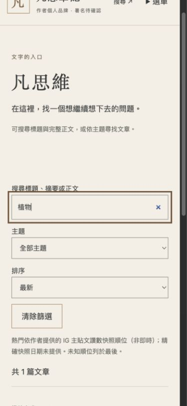

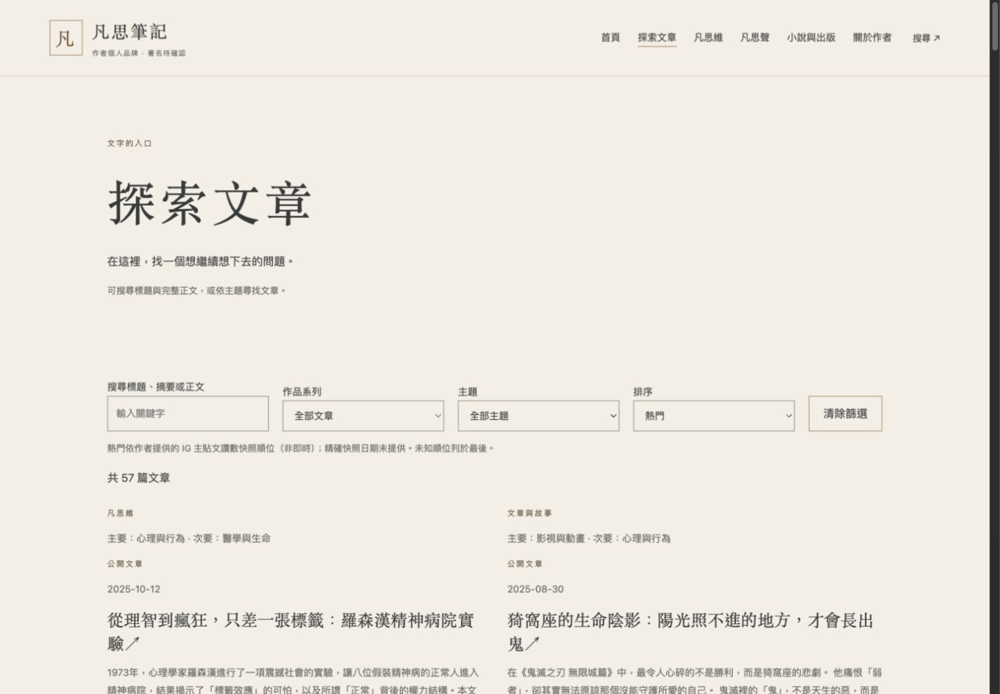

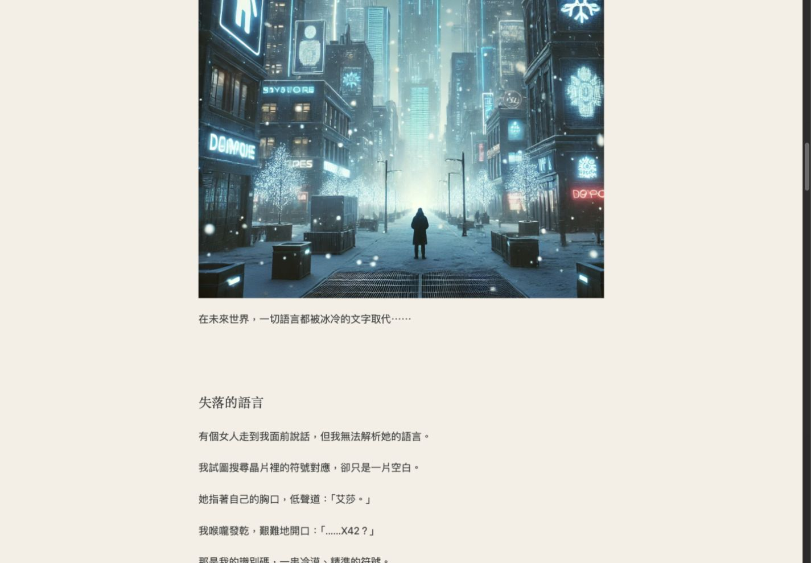

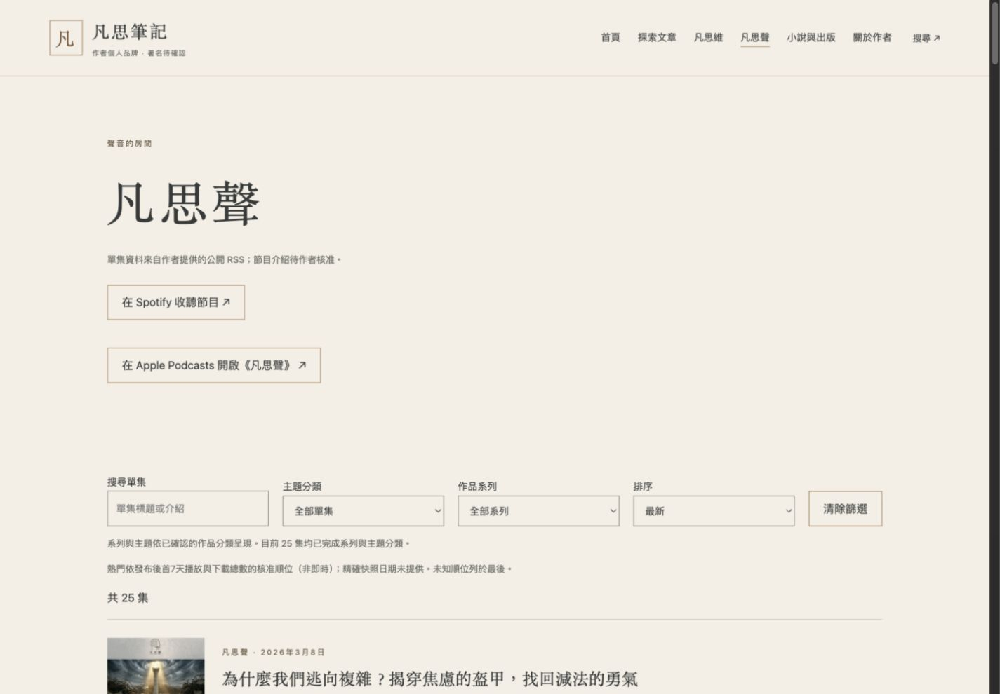

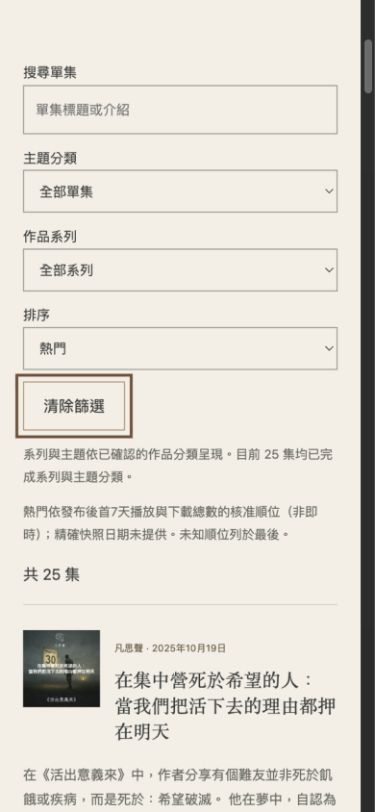

## 最後一批：已實作／測試通過／待作者驗收

從最新文件提交3d63674續作，未退回105d145覆蓋交接。

### 實際修改
- site.ts／Main.astro：共用頁尾IG小圖示與帳號文字、新分頁安全屬性及可讀標示；各篇貼文網址不變。
- WorkCard／UnifiedWorkCard：固定文字卡，不再使用cover_image或合成占位圖；詳頁／Podcast封面不變。
- ArticleBrowser／article-browser.mjs：凡思維直接使用完整works的confirmed作品，計數「作品」，純音訊有收聽入口、未知IG順位null；一般文章瀏覽仍限文章。
- article-images.json／article-images.mjs／article-image-state.mjs／文章詳頁：原位置接圖、重複處理冪等、同位置唯一、原比例及alt；將必要來源移至圖片專屬容器外，載入失敗只收合圖像／圖說。
- 原位更新IMAGE_ACTION_LEDGER、工程SOP、CURRENT_STATE及本驗收；原61項保障保留，新增3項針對性測試及既有隔離建置fixture。沒有改寫57篇或更換approved-baseline。

### 151筆結果與具體例外
全部151個既有URL均實際GET為200、可解碼，並檢視實圖；各筆保存URL、唯一鍵、用途觀察、結果、尺寸與檢查雜湊。未另行搜尋素材，原圖僅暫存檢視、不加入Repository。

| 結果 | 數量 | 原因 |
|---|---:|---|
| 接入 | 96 | 有敘事／知識用途的原插畫、照片、研究圖、示意圖及作品圖，保留原11張 |
| 省略 | 15 | Podcast宣傳卡，文末已提供收聽入口 |
| 省略 | 24 | 帶文章標題／品牌的社群封面卡，避免重複標題，非獨立內文圖 |
| 省略 | 16 | 完整文章文字、書單、延伸閱讀社群圖卡，不取代可選取正文 |

原三篇另8個缺URL位置不計入151；本版無圖。新九篇無獨立圖檔者無圖。研究圖有文字仍保留，例如四種躁鬱症曲線、健康童年比較及NMOSD比較圖。沒有推定全部圖片為作者原創。網路暫時失敗0筆；遠端未來仍可能失效，已驗證收合且必要研究連結保留。

### 驗證結果
- 原57篇檔案SHA256與既有核准基準一致；分類／日期／URL包含在位元保護內。25組映射、原16組、人氣JSON基準驗證通過。Podcast與分類JSON相對3d63674無差異。
- 受影響單元及隔離建置先通過。收尾Astro check 77 files／0 errors／0 warnings／0 hints；build107頁；完整測試64/64（原61＋3），GitHub CI見PR最新Checks。
- 隔離有封面文章在首頁／探索文章／凡思維／主題沒有縮圖，詳頁仍有正式封面；Podcast圖片仍存在。
- 隔離純音訊能在凡思維搜尋到，只有收聽、沒有文章路由，rank空值；配對後同作品一張卡。其他系列與proposed不混入，一般文章不增加假文章；正式dist沒有fixture。
- 151筆唯一鍵均對應原標記，96張執行資料與清冊一致；同位置重複或整體重跑不多插圖。原11張由獨立fixture保護。
- 實際1440px：凡思維兩欄540px＋540px；主題單欄與清除維持原society／10作品；文章57、凡思維8作品。390px單欄327px。360px文章／凡思維／主題／研究圖scrollWidth345，沒有水平溢出。
- 頁尾IG於共用各頁建置驗證；實際鍵盤Tab可聚焦IG並有可見外框，href正確、新分頁已標示。文章文末仍為單篇IG。
- 摘要DOM不在a內且user-select非none；瀏覽器工具對一般段落按鍵不支援，因此沒有宣稱已實際複製到剪貼簿。作者可在預覽反白／長按試用。
- 隔離404圖片實際觸發失敗：無來源的整塊收合；含來源者僅圖片及圖說收合，必要研究來源與正文仍在。研究圖在手機327px／桌機720px載入成功，保留完整長寬比。

### 本輪實際畫面
合成fixture截圖只證明邊界案例，沒有加入正式文章或索引。

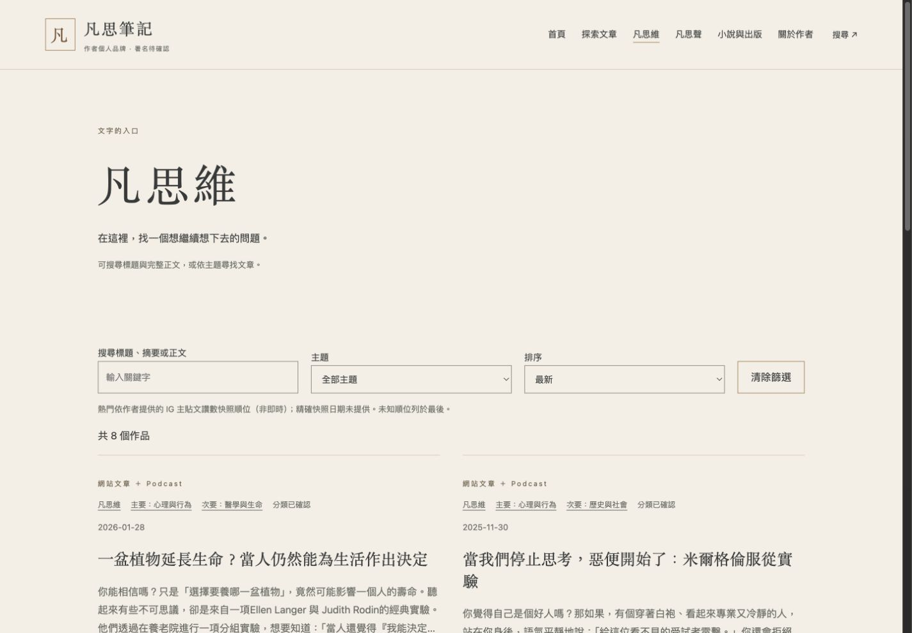
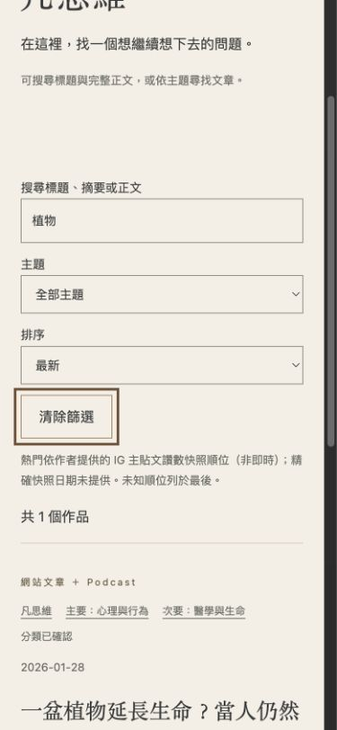
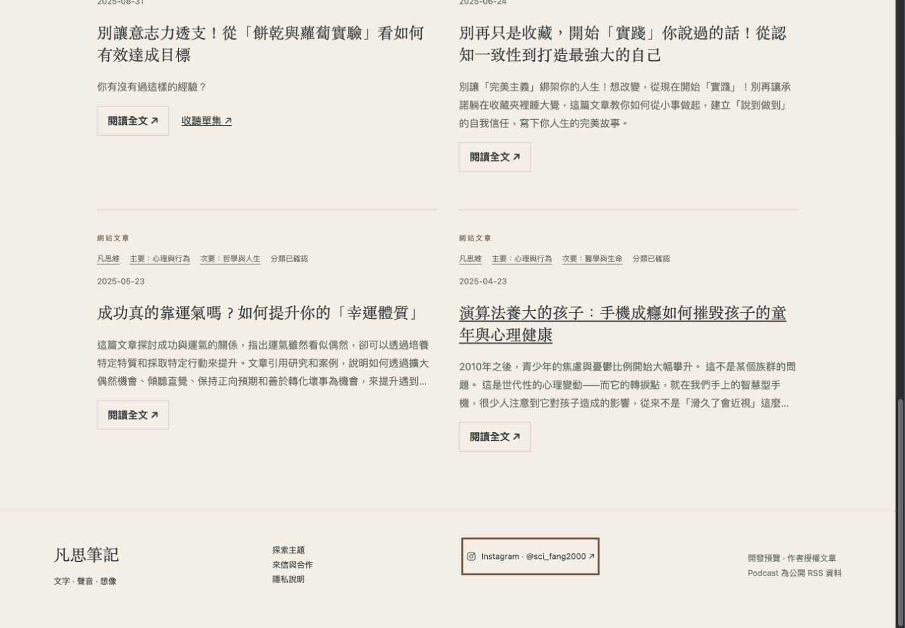
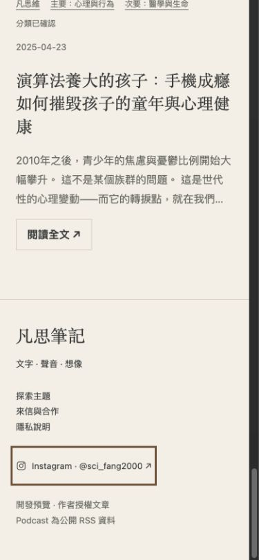
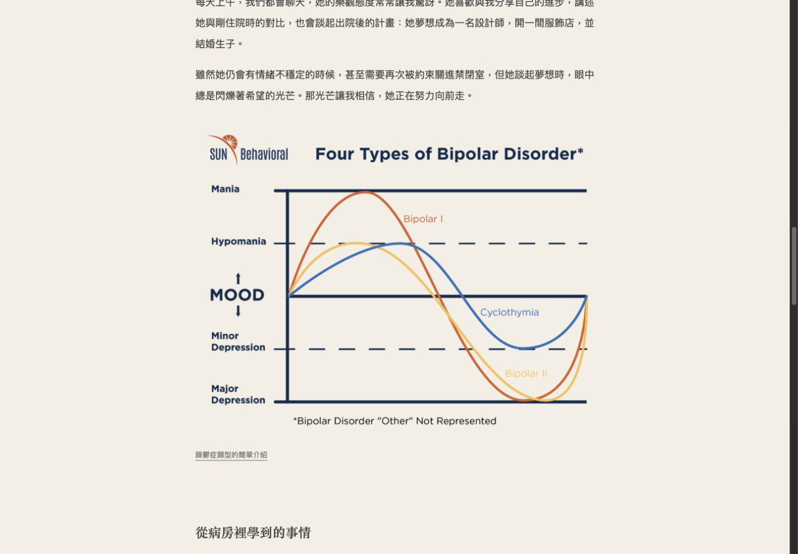
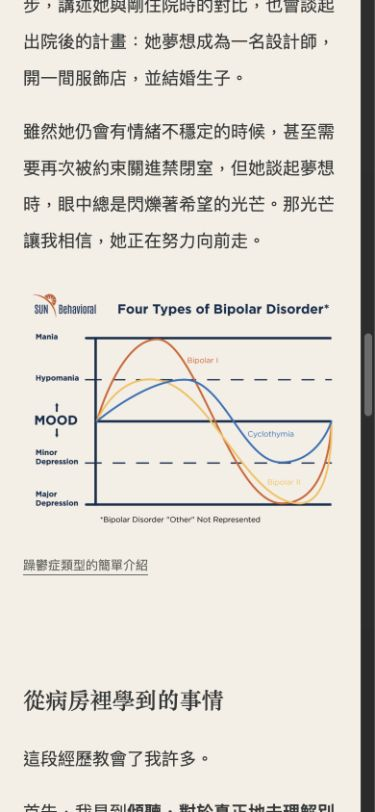
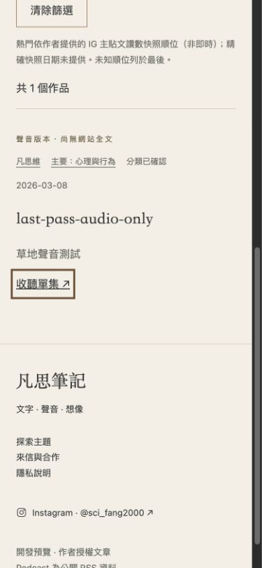
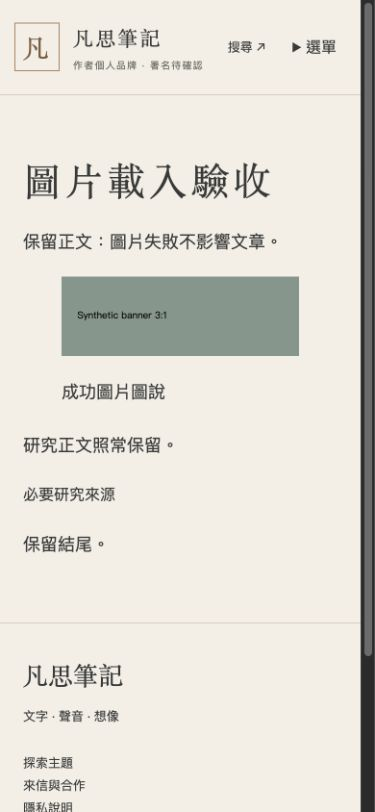

未合併、未部署、未啟用服務。作者驗收後下一批M5-E，本輪沒有啟動。
