# 真實 staging 接線驗收

## 真實 staging 接線（2026-11-16，作者已接受／安全補驗保留）

- 同一 PR #21 接續工程提交 `8bad741`，保留 PR #20 依賴；未合併、未部署正式官網、未解除 noindex、未升級付費。
- 作者已完成官方 Wrangler OAuth；短期受限 Token 補足 Access 設定權限。實際帳號、既有組織與 One-time PIN 已核對，沒有重建組織。先核對兩個 Access 應用的精確作者允許政策，再部署 staging 前台與私人管理 Worker；公開留言 API 不要求 Access 登入。三個 Worker 均停用 preview URL。
- 本專案 staging D1 已套用 0001／0002；真 Turnstile、發表、重整持久保存、同瀏覽器自刪、作者回覆與原文定位、待審→公開→隱藏→刪除皆已實測。刪除父留言後保留回覆。只有少量明示合成的驗收資料，沒有搬入本地13則示範或任何真實讀者內容；驗收後先審模式與暫停均恢復關閉。
- 作者親自完成 OTP，受控前台及私人管理可操作。匿名與偽造憑證對管理頁／列表／設定／匯出及前台資產均被 Access 阻擋；獨立請求錯誤自刪憑證、跨 origin 與無效 Turnstile 均遭拒，公開 API 無管理路由。**第二個真實非白名單帳號尚未操作驗證**；本地錯誤身分／JWT測試與精確政策查核不能代替這一項。
- 唯一一封「凡思筆記｜接線驗收」合成信已由受控聯絡頁送出，Formspree 接受，**作者已確認 Gmail 實收**；不再重寄。僅增加選填 `PUBLIC_CONTACT_SUBJECT` 隱藏欄位，普通建置未設定即不產生。公開 Email 備援仍關閉。
- GoatCounter **測試站**控制台已看到文章／聯絡頁瀏覽、留言／來信提交及一次 Vocus 外連事件；只含固定路徑、作品ID與事件名稱。正式與測試控制台匿名均只顯示登入頁；沒有向正式站送驗收流量，也沒有公開統計。
- 私人設定、資源ID／實際管理書籤、原始操作紀錄與停用方法均在 Repository 外，目錄0700、設定0600；公開文件僅保留去識別驗收。正式 production 仍未設定，普通 build 三服務預設關閉，公開頁面不輸出管理入口。
- 保留原90項保障，現91項；本輪完整測試、check、build與CI結果見同批README／PR最新HEAD。57篇文章、25集Podcast與配對、96張圖片、7筆出版／26連結、作者資料與人氣均未修改。
- 作者已親自接受本輪操作與視覺，並確認撤銷 fansi-access-staging-setup；不再要求重驗視覺或重建Token。第二個真實非白名單帳號與獨立瀏覽器自刪仍列安全待驗，接續M5-F，不代表授權合併或production。

### 本輪驗證與畫面

本輪保留既有互動介面，只補聯絡信件的選填主旨與隔離建置回歸。受控前台沿用Astro正式頁面，並非獨立示意HTML。以下皆為真實staging與合成驗收內容，無管理網址列、白名單或密鑰。

|桌機1440px|手機390px|
|---|---|
|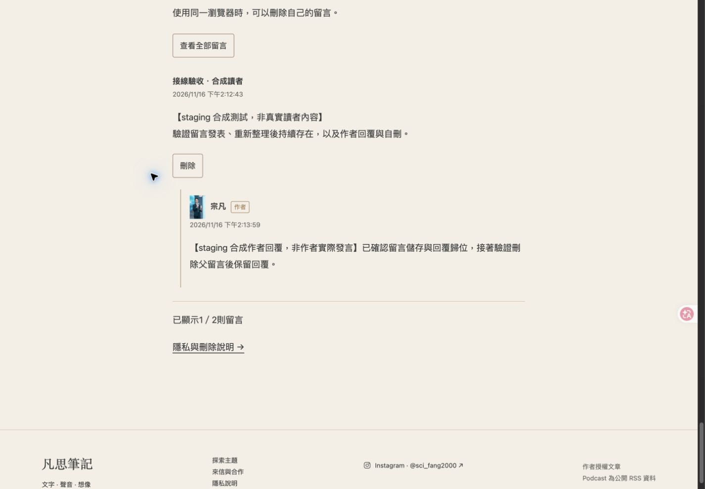|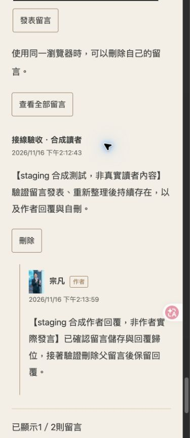|
|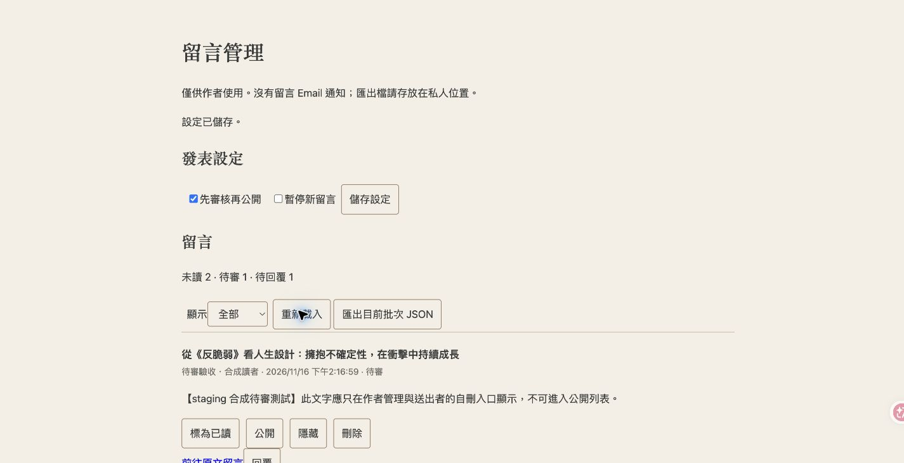|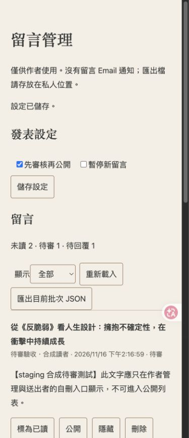|
|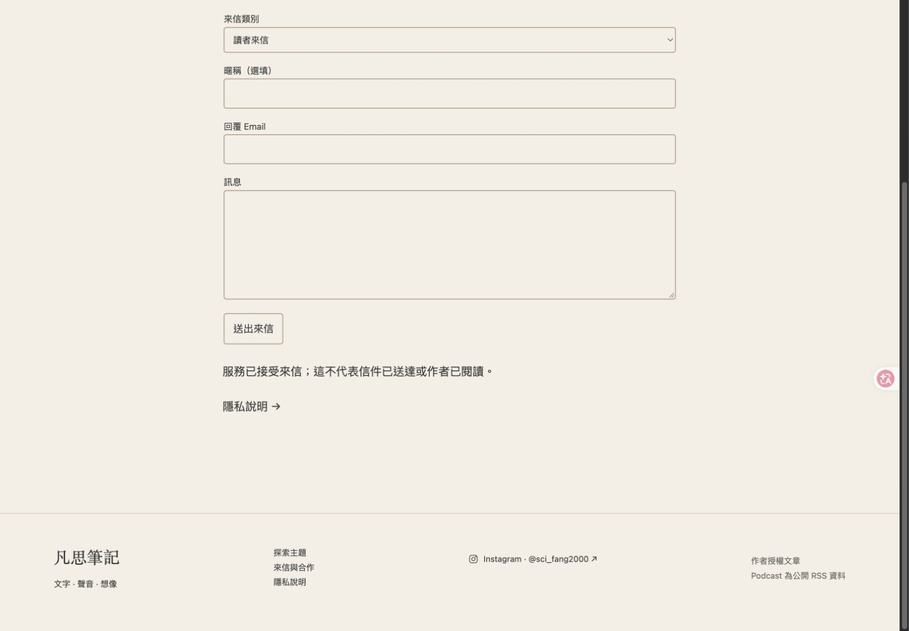|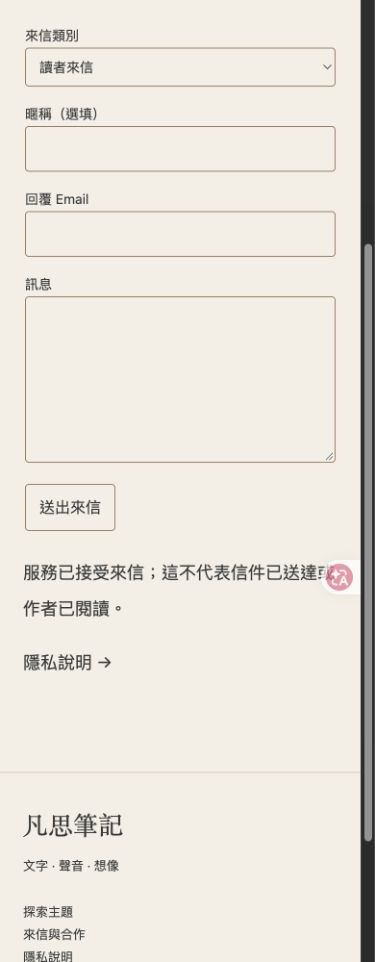|

管理截圖保留測試過程的先審狀態，驗收後已恢復一般模式。手機留言長文字與按鈕可閱讀，管理頁360px檢查無水平溢出（innerWidth360／scrollWidth345）；留言及聯絡390px實際畫面無溢出。鍵盤焦點可見。此次未以失敗的viewport切換冒稱所有頁面360px皆已重新驗收。

- 真實自刪：持有瀏覽器憑證成功；另一個獨立HTTP客戶端無本人憑證403。未另以第二套真實瀏覽器登入測試。
- 真實留言操作期間產生兩筆公開合成主留言；不能據此聲稱遠端雙擊冪等已獨立驗證。重送／回應遺失保障仍由本地真SQL測試驗證。
- 匿名／偽造JWT被雲端Access阻擋；錯email、audience、issuer、過期、簽章與來源驗證仍由本地安全測試覆蓋。非作者真實帳號登入仍待補驗。
- 私人管理回覆、發布、隱藏、刪除、審核開關與返回原文均已操作；沒有啟用留言Email通知或推播。
- Gmail實收由作者明確確認，不讀取其他私人信件。測試控制台事件已實際可見，不將外連點擊稱為收聽／購買。

作者日常操作：私人書籤登入管理 → 找到留言按「回覆」 → 按「前往原文留言」返回對應位置。實際staging書籤與資源停用清單私下交付，不寫公開PR；這不是production管理網址。

本輪輸入檢查、64串清冊檢查、local／staging預檢通過；Astro check 114檔零錯誤／警告／提示、114頁build、91項測試全部通過。三個Worker已實際staging部署。前一工程提交8bad741的CI #126全綠；本次提交CI結果以PR #21最新HEAD為準。

以下為已完成的本地歷史驗收，不能替代本輪真實服務證據。

# 公開管理入口移除（歷史）

本輪公開管理入口移除：程式與本地權限測試已完成；90項測試、check零錯誤／警告／提示、114頁build、輸入檢查／服務預檢、兩個Worker dry-run通過。正式Access政策與真實登入尚待接線驗證；GitHub CI以PR #21最新HEAD為準。

直接移除公開頁尾、留言連結與前端管理URL邏輯，不靠CSS隱藏。作者改用私人書籤→Access驗證→集中管理；管理頁返回原文的單向導航保留。正式管理網址尚未建立，只在私人本地設定交付，不寫公開PR／README。

既有留言10則分批、宗凡照片與徽章、自刪、回覆歸位、管理操作及認證均保留。原有內容資料未修改。本地程式與權限測試不代表正式Access政策／真實登入已驗證。

新增測試：啟用留言並注入舊管理URL的隔離build，掃描HTML、JS、map、XML等輸出；管理所有頁面／API測缺登入、錯Email、偽header、錯audience／issuer、過期與無效Token、缺設定及跨origin。既有88項保留，現在90項。

|桌機1440px|手機390px|
|---|---|
|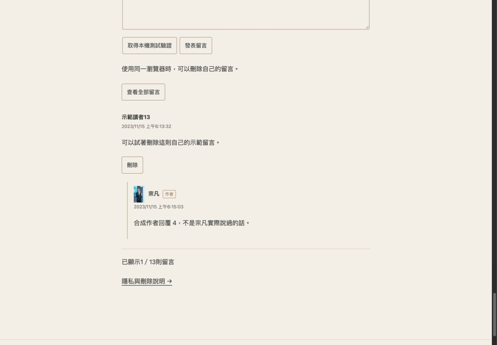|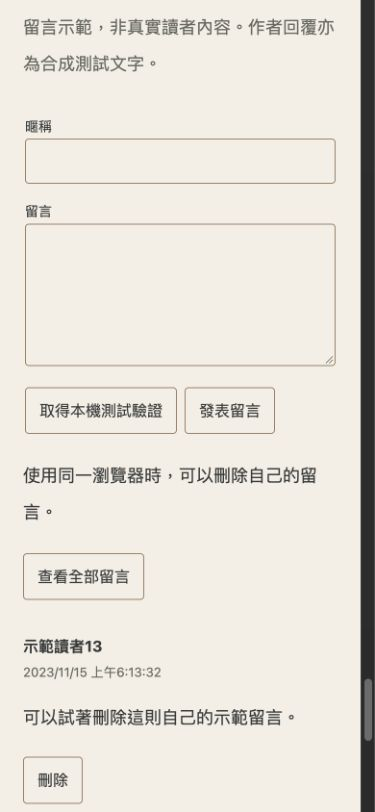|
|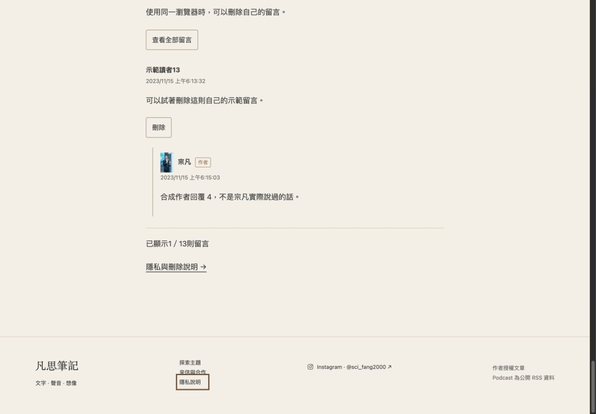|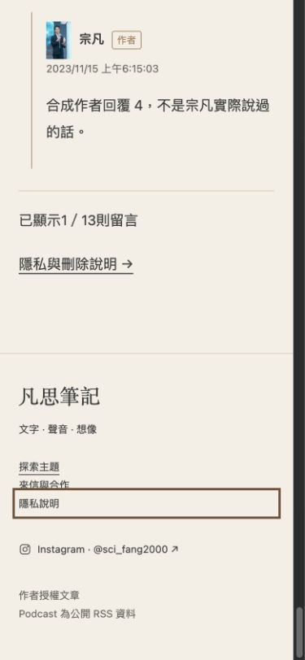|

以下為前輪歷史驗收；舊截圖曾含公開管理連結，已由本輪取消。

# 留言閱讀與作者管理調整（歷史）

**留言介面與管理體驗已實作／本地及CI測試通過／待作者視覺驗收與免費帳號設定、真實接線。** 工程提交 `e5ef26b3d22a0309a1e538675de6784fb2dba7d2`：[CI #123 全綠](https://github.com/QuantumMedic/fansi-notes/actions/runs/43800453776)，88項測試通過；未合併或部署。

沿用PR #21，基線306c431；本輪尚未啟用任何真實服務。舊管理碼操作介面已取消，以下歷史截圖不再代表現行讀者UI。

## 本輪實作

前台表單在前，主留言最新優先，每批10則；作者回覆歸位、每批10則、手動載入。總數排除待審／隱藏／作者回覆；已刪父留言只有公開回覆時保留匿名位置。有限查詢可直接定位第11則以後留言。

憑證自動保存、記憶體fallback、自刪按鈕隨本人留言顯示；待審本人另有刪除入口。不提供複製、下載或跨裝置恢復。作者固定顯示宗凡、既有照片與server徽章。

管理新增作品標題與原文定位、持久未讀、待審／待回覆真實統計、明確已讀操作、按需回覆欄。管理頁與所有API都由Access JWT驗證；本機使用隔離簽章測試身分。0002是增量SQL，未遠端執行。

## 操作預覽

[反脆弱示範留言](http://127.0.0.1:4335/fansi-notes/articles/antifragile-life/#comments) · [本機管理](http://127.0.0.1:8788/admin/)

1. 用私人書籤開啟獨立管理頁，通過Access驗證。
2. 在集中列表找到作品與留言，按「回覆」填寫後送出。
3. 管理頁「前往原文留言」返回正確留言位置，包括第11則以後。

seed由scripts/seed-local-comments.mjs生成，僅local adapter使用。13公開、4作者回覆、1待審；重跑不新增重複資料。本機重啟可恢復初始範例，非真實讀者留言。

## 本輪驗證

- 既有86項保障保留；新增真D1閱讀／管理及UI配置測試，88項。check零錯誤，build114頁；輸入檢查、公開清冊與服務預檢通過。CI以本PR最新HEAD為準。
- 瀏覽器實測10/13→13/13、回覆歸位、本人刪除入口、管理精確定位第13則與返回原文；1440/390截圖，360px無水平溢出，Tab焦點可見，長留言保留段落與正常字級。
- 原文hash與正式內容資料不變；正式HTML不含示範文字或localhost管理網址。Formspree及GoatCounter未重做。
- 帳號清單仍為[ACTIVATION_CHECKLIST](ACTIVATION_CHECKLIST.md)，保留私人ADMIN_WORKER_URL、SITE_ORIGIN、SITE_BASE，公開端不使用管理網址。真Access登入、Gmail實收、線上留言與分析仍待接線。

|1440px|390px|
|---|---|
|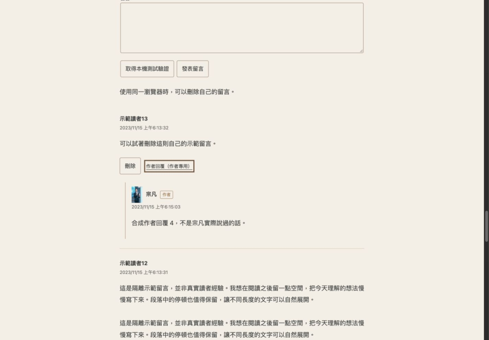||
||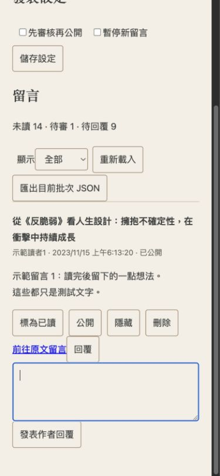|

---
## 第一輪歷史驗收（管理碼UI已取代）

# M5-E 免費互動｜第一輪本地實作驗收

2026-11-16。**互動程式已實作／本地與CI測試通過／待帳號設定及真實接線**；工程提交 `313d50cada8e8fccde869dedf3b23c67a8284c88` 的 [GitHub CI #121](https://github.com/QuantumMedic/fansi-notes/actions/runs/43796342999) 全綠（輸入檢查、check、build、86項測試）；後續文件提交以PR最新HEAD檢查為準。父提交`8d0819c82d0437c2feeb986f2754c7b14efd3077`，本PR依賴#20，沒有改動#19/#20，沒有合併、部署、解除noindex或啟用服務。

## 實作範圍

- `services/comments/`：public與admin兩個Worker，D1 SQL遷移、參數化查詢、持久限流、單次token重播防護、分頁、冪等發表、逐則私碼自刪、作者回覆／隱藏／刪除／先審核／暫停與認證匯出。刪父留言不級聯刪除回覆。
- `access.mjs`採jose驗證RS256 JWT簽章、issuer、audience、有效期、必要claims及精確Email；不信任Email header。admin所有路徑預設拒絕，寫入同origin＋JSON；public沒有管理路由。
- `comment-threads.mjs`＋`sync-comment-threads.mjs`產生公開清冊64個串／25個別名。正式資料新增可重跑，build自動同步，CI檢查；未配對GUID日後配對有僅輸出SQL的遷移計畫工具，必須備份與另外授權才套用。
- `Comments.astro`、`comments.ts`：按鈕才載入公開留言；暱稱／純文字、表單防雙擊、重試保留ID與碼、管理碼本地保存／複製／下載／手動恢復、儲存失敗警示。管理碼遮蔽顯示；不放URL或公開API回應。作者徽章只由server author欄位渲染獨立元素，暱稱不能生成徽章。
- `ContactForm.astro`：Formspree AJAX adapter、蜜罐欄位、送出中／接受／失敗／逾時／429；失敗保留輸入，不自動重寄。JS未啟用時表單disabled且說明，未設定不能假送出。私人收件地址未寫入repo；備援Email另行批准才公開。
- `Analytics.astro`與事件白名單：未設定、localhost、CI、admin、review不載入；只傳固定事件／公開路徑／核准work_id，去除query／fragment／referrer及自由輸入。不將外連稱為實際購買或收聽。
- 三服務獨立設定、隱私頁更新；只對既有ServiceState和文章／Podcast／出版詳頁接thread。沒有重設版型，沒有改寫內容。

## 可操作本機版本

依[集中啟用清單](ACTIVATION_CHECKLIST.md)執行兩個命令：`npm run services:local`、`npm run dev:services`。

- 前台：`http://127.0.0.1:4335/fansi-notes/articles/antifragile-life/`（文末留言）；`/fansi-notes/contact/`。
- 管理：`http://127.0.0.1:8788/admin/`，只在本地adapter使用合成JWT；正式Worker無測試bypass。
- 本地D1為隔離記憶體資料，重啟清空；資料不進Git或artifact。來信`[quota]`／`[timeout]`／`[failure]`只觸發本地provider對應錯誤，沒有真信。一般合成訊息回傳接受。
- 正式build所有服務預設關閉；不含local管理頁、私密測試DB或secret。CI artifact只含靜態dist。

## 測試結果

|項目|結果|
|---|---|
|`python3 scripts/check_m5e_inputs.py`|通過，七作品／26入口／照片hash／三段／13事件原樣|
|`npm run check`|0錯誤、0警告、0提示|
|`npm run build`|114頁，正式服務關閉|
|`npm test`|86/86通過，原73項保留＋新增13項，無跳過|
|Miniflare本地D1|真SQL migration、insert/select/update、唯一性、父子關係、rate limit與token表，非全mock|
|JWT安全|有效簽章、缺設定、假header、錯Email／issuer／audience、過期及無簽章拒絕|
|公開API|自己刪／他人拒絕、雙擊／回應遺失、未知串、parent拒絕、假作者欄位無效、XSS純文字／SQL injection、長度／body限制、跨origin、限流、Siteverify hostname/action、token重播、正式dummy拒絕|
|設定與隱私|local-ready通過；staging完整缺項輸出，secret不印出；正式不接受local端點與dummy；分析事件不收私人內容|
|兩個Worker打包|Wrangler `deploy --dry-run`成功，只寫本地outdir，未上傳／部署|
|依賴安全|固定jose／wrangler／miniflare版本；npm audit 0漏洞（本輪檢查時間）|

既有隔離建置測試只新增複製公開generated清冊，全部原斷言保留。原文hash基準、57篇文章、25集／25映射、96圖片、人氣／分類、7出版／26入口、作者／照片、首頁五場景與分頁未改。`git diff`已逐項確認。

## 瀏覽器實測

1440px桌機、390px手機；360px留言與管理無水平溢出。保留既有色系；服務元件無新增動畫，鍵盤Tab到保存碼按鈕時焦點框可見。

- 成功發表合成A，服務回傳公開並在列表顯示；管理者回覆，切先審核模式。
- 讀者用自己的管理碼刪除A，正文／暱稱清空，作者回覆仍顯示。
- 合成B送出後顯示待審，公開列表沒有B，管理待審篩選能找到。
- 聯絡本地接受、429與12秒逾時；逾時期間按鈕停用，恢復後文字仍在，不自動重送。成功僅表述服務接受。
- 真Access OTP、真Turnstile網路挑戰、Gmail收件及GoatCounter線上控制台尚未測試，不能用本地結果替代。

|桌機1440px|手機390px|
|---|---|
|||
|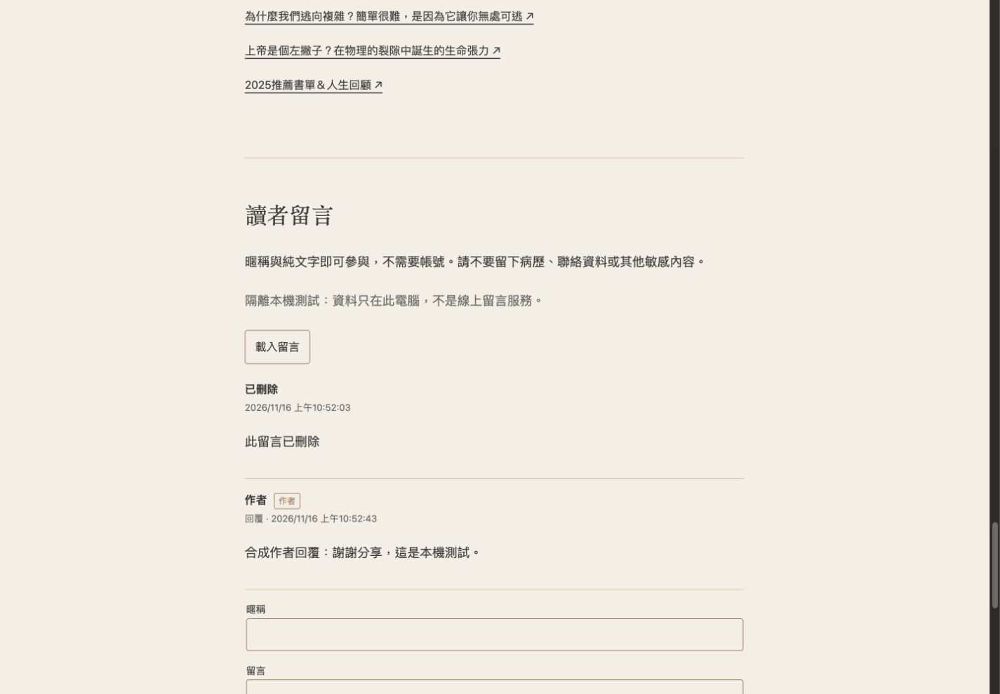||
|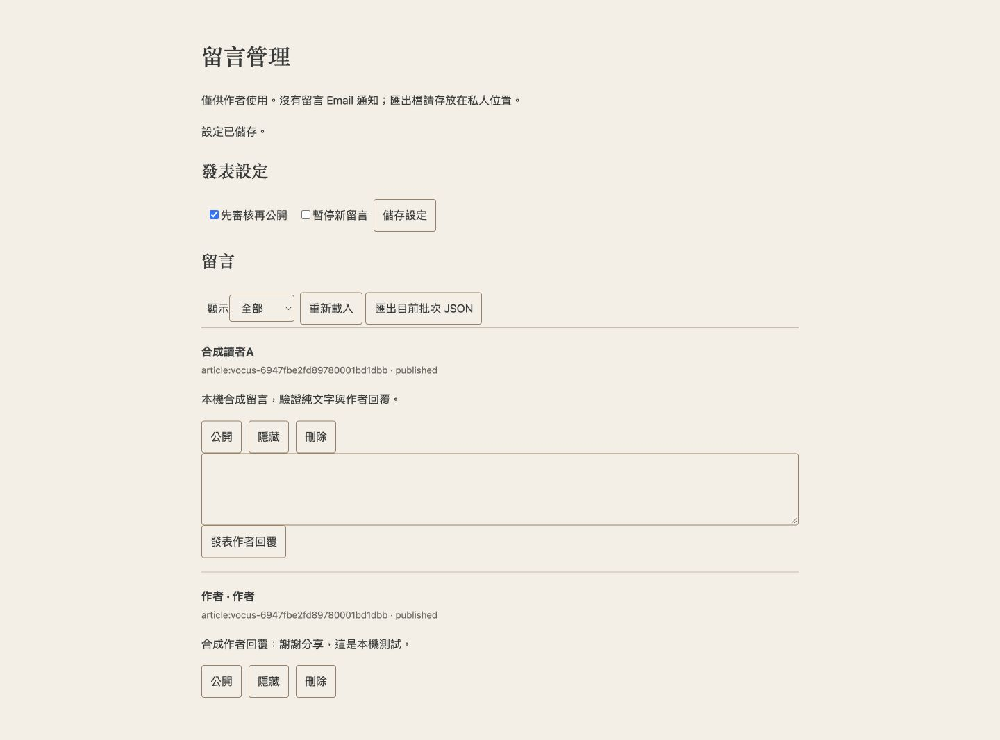|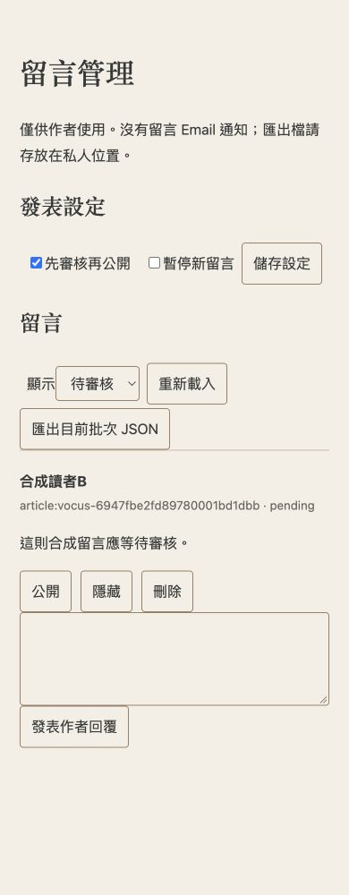|
|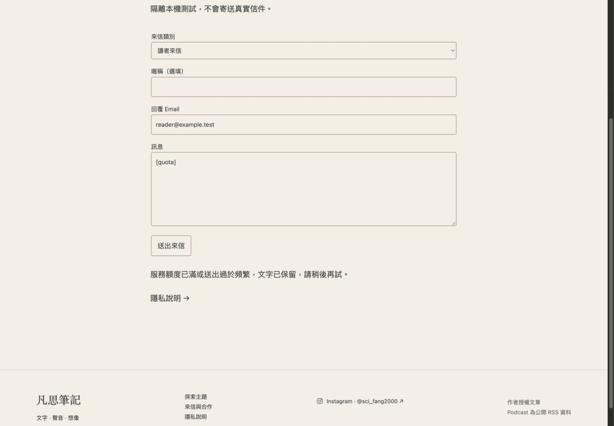||

截圖只含合成資料。管理碼遮蔽；沒有真Email、留言匯出或使用者私人資料。

## 待帳號設定與真實接線

唯一清單為[ACTIVATION_CHECKLIST](ACTIVATION_CHECKLIST.md)：Cloudflare登入／免費方案、兩環境D1與兩Worker URL、Turnstile、Access精確白名單／OTP、Formspree後台收件驗證、GoatCounter私人測試代碼，以及公開Email與受控測試部署／真信授權。所有未知ID保持空值，不造假。

未建立帳號、未套遠端migration、未發真信、未啟用統計。接線在同PR進行；M5-F全站驗收及M6部署另行授權。

## 技術依據

本輪只查核實作API，不重選服務：[Cloudflare Siteverify](https://developers.cloudflare.com/turnstile/get-started/server-side-validation/)、[Access JWT](https://developers.cloudflare.com/cloudflare-one/access-controls/applications/http-apps/authorization-cookie/validating-json/)、[Formspree AJAX](https://help.formspree.io/articles/building-your-form/submit-forms-with-javascript-ajax/)。免費方案實際帳號限制在集中設定時再次確認，不自動升級。
