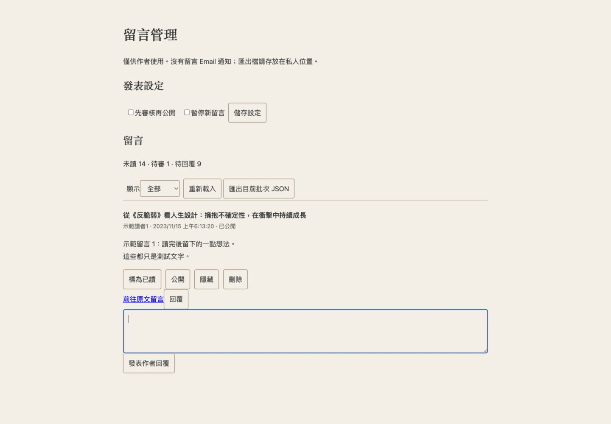
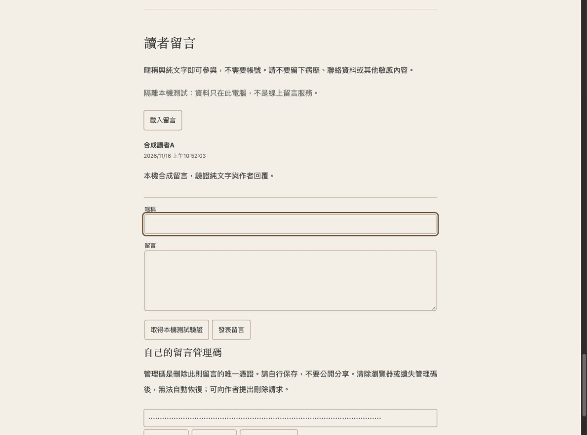
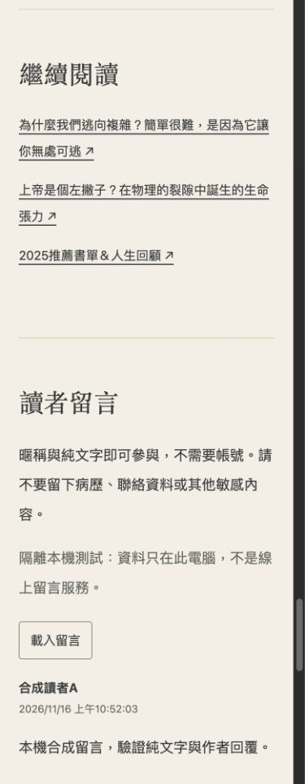
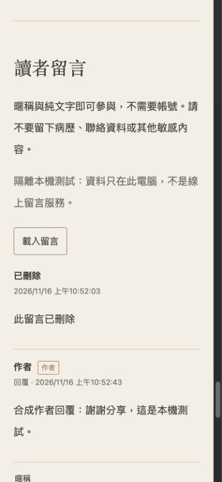
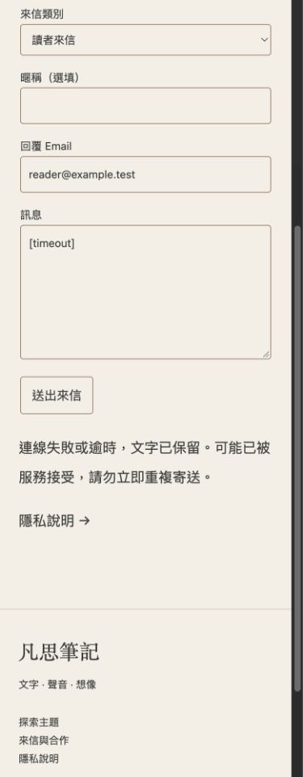

# 留言閱讀與作者管理調整（最新）

沿用PR #21，基線306c431；本輪尚未啟用任何真實服務。舊管理碼操作介面已取消，以下歷史截圖不再代表現行讀者UI。

## 本輪實作

前台表單在前，主留言最新優先，每批10則；作者回覆歸位、每批10則、手動載入。總數排除待審／隱藏／作者回覆；已刪父留言只有公開回覆時保留匿名位置。有限查詢可直接定位第11則以後留言。

憑證自動保存、記憶體fallback、自刪按鈕隨本人留言顯示；待審本人另有刪除入口。不提供複製、下載或跨裝置恢復。作者固定顯示宗凡、既有照片與server徽章。

管理新增作品標題與原文定位、持久未讀、待審／待回覆真實統計、明確已讀操作、按需回覆欄。兩條入口都由Access JWT驗證；本機使用隔離簽章測試身分。0002是增量SQL，未遠端執行。

## 操作預覽

[反脆弱示範留言](http://127.0.0.1:4335/fansi-notes/articles/antifragile-life/#comments) · [本機管理](http://127.0.0.1:8788/admin/)

1. 網站頁尾「作者登入」進管理首頁。
2. 主留言「作者回覆（作者專用）」直接定位，填寫後送出。
3. 管理頁「前往原文留言」返回正確留言位置，包括第11則以後。

seed由scripts/seed-local-comments.mjs生成，僅local adapter使用。13公開、4作者回覆、1待審；重跑不新增重複資料。本機重啟可恢復初始範例，非真實讀者留言。

## 本輪驗證

- 既有86項保障保留；新增真D1閱讀／管理及UI配置測試，88項。check零錯誤，build114頁；輸入檢查、公開清冊與服務預檢通過。CI以本PR最新HEAD為準。
- 瀏覽器實測10/13→13/13、回覆歸位、本人刪除入口、管理精確定位第13則與返回原文；1440/390截圖，360px無水平溢出，Tab焦點可見，長留言保留段落與正常字級。
- 原文hash與正式內容資料不變；正式HTML不含示範文字或localhost管理網址。Formspree及GoatCounter未重做。
- 帳號清單仍為[ACTIVATION_CHECKLIST](ACTIVATION_CHECKLIST.md)，補PUBLIC_COMMENTS_ADMIN_URL、SITE_ORIGIN、SITE_BASE。真Access登入、Gmail實收、線上留言與分析仍待接線。

|1440px|390px|
|---|---|
|||
|||

---
## 第一輪歷史驗收（管理碼UI已取代）

# M5-E 免費互動｜第一輪本地實作驗收

2026-11-16。**互動程式已實作／本地與CI測試通過／待帳號設定及真實接線**；工程提交 `313d50cada8e8fccde869dedf3b23c67a8284c88` 的 [GitHub CI #121](https://github.com/QuantumMedic/fansi-notes/actions/runs/43796342999) 全綠（輸入檢查、check、build、86項測試）；後續文件提交以PR最新HEAD檢查為準。父提交`8d0819c82d0437c2feeb986f2754c7b14efd3077`，本PR依賴#20，沒有改動#19/#20，沒有合併、部署、解除noindex或啟用服務。

## 實作範圍

- `services/comments/`：public與admin兩個Worker，D1 SQL遷移、參數化查詢、持久限流、單次token重播防護、分頁、冪等發表、逐則私碼自刪、作者回覆／隱藏／刪除／先審核／暫停與認證匯出。刪父留言不級聯刪除回覆。
- `access.mjs`採jose驗證RS256 JWT簽章、issuer、audience、有效期、必要claims及精確Email；不信任Email header。admin所有路徑預設拒絕，寫入同origin＋JSON；public沒有管理路由。
- `comment-threads.mjs`＋`sync-comment-threads.mjs`產生公開清冊64個串／25個別名。正式資料新增可重跑，build自動同步，CI檢查；未配對GUID日後配對有僅輸出SQL的遷移計畫工具，必須備份與另外授權才套用。
- `Comments.astro`、`comments.ts`：按鈕才載入公開留言；暱稱／純文字、表單防雙擊、重試保留ID與碼、管理碼本地保存／複製／下載／手動恢復、儲存失敗警示。管理碼遮蔽顯示；不放URL或公開API回應。作者徽章只由server author欄位渲染獨立元素，暱稱不能生成徽章。
- `ContactForm.astro`：Formspree AJAX adapter、蜜罐欄位、送出中／接受／失敗／逾時／429；失敗保留輸入，不自動重寄。JS未啟用時表單disabled且說明，未設定不能假送出。私人收件地址未寫入repo；備援Email另行批准才公開。
- `Analytics.astro`與事件白名單：未設定、localhost、CI、admin、review不載入；只傳固定事件／公開路徑／核准work_id，去除query／fragment／referrer及自由輸入。不將外連稱為實際購買或收聽。
- 三服務獨立設定、隱私頁更新；只對既有ServiceState和文章／Podcast／出版詳頁接thread。沒有重設版型，沒有改寫內容。

## 可操作本機版本

依[集中啟用清單](ACTIVATION_CHECKLIST.md)執行兩個命令：`npm run services:local`、`npm run dev:services`。

- 前台：`http://127.0.0.1:4335/fansi-notes/articles/antifragile-life/`（文末留言）；`/fansi-notes/contact/`。
- 管理：`http://127.0.0.1:8788/admin/`，只在本地adapter使用合成JWT；正式Worker無測試bypass。
- 本地D1為隔離記憶體資料，重啟清空；資料不進Git或artifact。來信`[quota]`／`[timeout]`／`[failure]`只觸發本地provider對應錯誤，沒有真信。一般合成訊息回傳接受。
- 正式build所有服務預設關閉；不含local管理頁、私密測試DB或secret。CI artifact只含靜態dist。

## 測試結果

|項目|結果|
|---|---|
|`python3 scripts/check_m5e_inputs.py`|通過，七作品／26入口／照片hash／三段／13事件原樣|
|`npm run check`|0錯誤、0警告、0提示|
|`npm run build`|114頁，正式服務關閉|
|`npm test`|86/86通過，原73項保留＋新增13項，無跳過|
|Miniflare本地D1|真SQL migration、insert/select/update、唯一性、父子關係、rate limit與token表，非全mock|
|JWT安全|有效簽章、缺設定、假header、錯Email／issuer／audience、過期及無簽章拒絕|
|公開API|自己刪／他人拒絕、雙擊／回應遺失、未知串、parent拒絕、假作者欄位無效、XSS純文字／SQL injection、長度／body限制、跨origin、限流、Siteverify hostname/action、token重播、正式dummy拒絕|
|設定與隱私|local-ready通過；staging完整缺項輸出，secret不印出；正式不接受local端點與dummy；分析事件不收私人內容|
|兩個Worker打包|Wrangler `deploy --dry-run`成功，只寫本地outdir，未上傳／部署|
|依賴安全|固定jose／wrangler／miniflare版本；npm audit 0漏洞（本輪檢查時間）|

既有隔離建置測試只新增複製公開generated清冊，全部原斷言保留。原文hash基準、57篇文章、25集／25映射、96圖片、人氣／分類、7出版／26入口、作者／照片、首頁五場景與分頁未改。`git diff`已逐項確認。

## 瀏覽器實測

1440px桌機、390px手機；360px留言與管理無水平溢出。保留既有色系；服務元件無新增動畫，鍵盤Tab到保存碼按鈕時焦點框可見。

- 成功發表合成A，服務回傳公開並在列表顯示；管理者回覆，切先審核模式。
- 讀者用自己的管理碼刪除A，正文／暱稱清空，作者回覆仍顯示。
- 合成B送出後顯示待審，公開列表沒有B，管理待審篩選能找到。
- 聯絡本地接受、429與12秒逾時；逾時期間按鈕停用，恢復後文字仍在，不自動重送。成功僅表述服務接受。
- 真Access OTP、真Turnstile網路挑戰、Gmail收件及GoatCounter線上控制台尚未測試，不能用本地結果替代。

|桌機1440px|手機390px|
|---|---|
|||
|||
|||
|||

截圖只含合成資料。管理碼遮蔽；沒有真Email、留言匯出或使用者私人資料。

## 待帳號設定與真實接線

唯一清單為[ACTIVATION_CHECKLIST](ACTIVATION_CHECKLIST.md)：Cloudflare登入／免費方案、兩環境D1與兩Worker URL、Turnstile、Access精確白名單／OTP、Formspree後台收件驗證、GoatCounter私人測試代碼，以及公開Email與受控測試部署／真信授權。所有未知ID保持空值，不造假。

未建立帳號、未套遠端migration、未發真信、未啟用統計。接線在同PR進行；M5-F全站驗收及M6部署另行授權。

## 技術依據

本輪只查核實作API，不重選服務：[Cloudflare Siteverify](https://developers.cloudflare.com/turnstile/get-started/server-side-validation/)、[Access JWT](https://developers.cloudflare.com/cloudflare-one/access-controls/applications/http-apps/authorization-cookie/validating-json/)、[Formspree AJAX](https://help.formspree.io/articles/building-your-form/submit-forms-with-javascript-ajax/)。免費方案實際帳號限制在集中設定時再次確認，不自動升級。
