# 2026-11-16｜作者簡介與經歷年表

**已實作／本機測試通過／待作者驗收**。接續PR #20最新 `30cf574e84857e87906ece02762a7fdc621e707e`，只更新作者資料、作者頁、輸入指紋及驗證。未合併、未部署、未開始互動服務；GitHub CI請見PR最新HEAD。

- 唯一來源：`AUTHOR_PAGE_COPY_AND_TIMELINE_2026-11-16.json`。三段介紹逐字保留，以既有bio字串的空行儲存並渲染三個自然段落；首頁仍讀同一筆short_bio。
- 13項事件完整保留，新至舊分為9個年份群組；「2024 起」不混成2024畢業事件。小型類別與標題為schema最小擴充，沒有高聳卡片或彩色徽章。
- 11個公開來源href與輸入逐筆一致，兩個無URL事件只顯示文字。DOI顯示全文，Tab可移至下一個來源、焦點框可見；本次不重新搜尋履歷或驗證外站內容。
- 內容保護：人氣獎、星雲初選提名、ASCAPAP研究團隊、第一作者Letter to the Editor、DOI及曾任職務均有精確回歸；《天啟Ⅰ》2017首次出版與書架2019版本分開。
- `author.json`與輸入包作者部分同步；PACKAGE_INDEX更新input blob與作者來源blob，既有照片hash及其他作品資料完全不變。
- `python3 scripts/check_m5e_inputs.py`通過；`npm run check`：85檔0 errors／warnings／hints；`npm run build`：114頁；`npm test`：73/73通過（原71項＋新增2項），無跳過。
- 本輪git差異不含七本小說、26媒介入口、57篇正文／雜湊基準、25集Podcast／25映射、96張內文圖、人氣、分類、首頁五場景、推薦元件、購書入口或照片。輸入包非author部分與父提交逐值一致。

## 作者頁實際畫面

|寬度|實際結果|
|---|---|
|1440px|照片與文字並排，三段、13項、11來源完整，無溢出|
|390px|照片與文字上下排列，年表單欄，來源不溢出|
|360px|innerWidth360／文件寬345，無main元素右側溢出；來源鍵盤焦點可見|

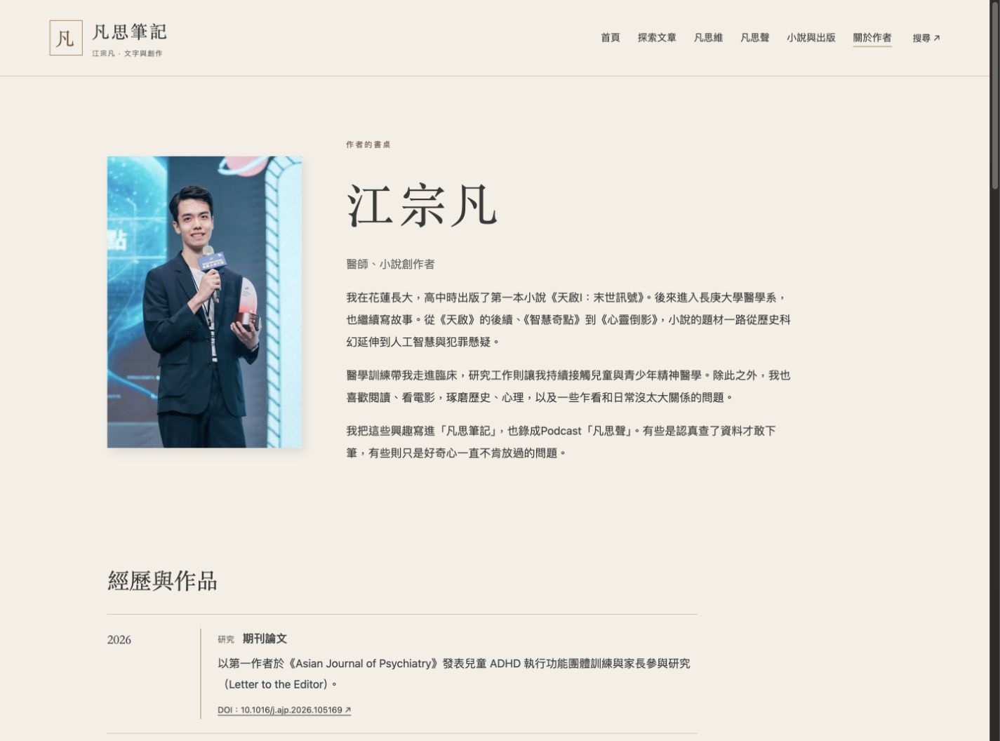
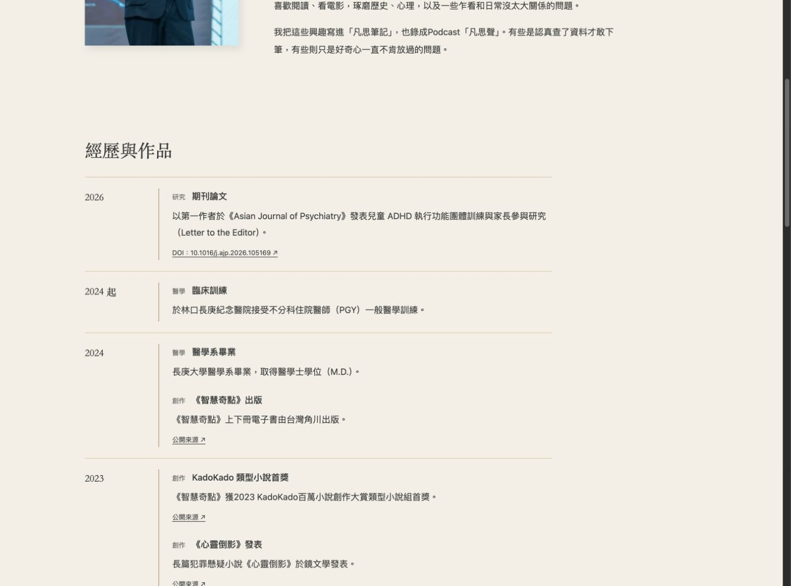

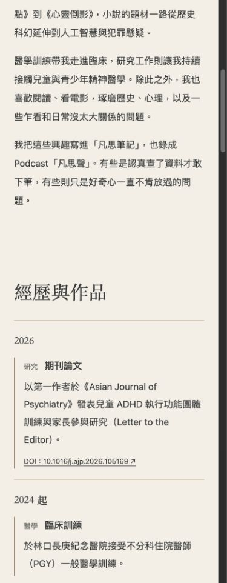

以下保留前一批作品頁驗收與外站例外；讀墨官網單冊入口尚未完全核實，不影響本批作者內容接線。

---

# 2026-11-16｜主要展示最後修正

**已實作／本機測試通過／待作者驗收**。接續 `c797cbf51b4058248cf1e3cb94e26d990278ee79` 最新資料，不覆寫七筆文案或26筆入口；同一PR #20，依賴仍為PR #19，未合併、未部署、noindex不變。GitHub CI以本PR最新HEAD檢查為準。

## 本輪變更與實際結果

- `Endorsement.astro`：推薦者署名由footer改為局部署名容器，避開全域footer的50px padding與flex。保留米色底、銅色細線、字型；引言後12px即為署名，來源緊接其下。每卡只有來源文字是連結，文字可選取，無整卡連結。
- `works/[slug]/index.astro`：移除slice與details，全部推薦直接渲染。桌機兩欄、手機單欄、align-items:start，卡片依內容高度；實測天啟Ⅲ桌機各卡約125–193px，沒有強制同高。完整故事仍用既有自然段落與欄寬，沒有改寫或刪減。
- `tests/m5e-display.test.mjs`：保留原71項測試，強化每頁四段正文、推薦數量／逐字內容／署名／來源、沒有折疊或誤用footer、26筆入口無重複且正確分組。取消過時「必須有details」斷言，換成全數可見的保障。
- 全域CSS與Main頁尾完全未改；實測桌機頁尾仍flex、手機block。推薦署名為block、padding 0，沒有全站頁尾內距污染。鍵盤Tab可到來源連結且焦點框可見，雙擊引言能選取文字。

|作品|完整故事段落|直接顯示推薦|平台入口／其中博客來|
|---|---:|---:|---:|
|天啟Ⅰ|4|3|5／2（紙本、電子書）|
|天啟Ⅱ|4|4|5／2（紙本、電子書）|
|天啟Ⅲ|4|5|5／2（紙本、電子書）|
|智慧奇點上|4|4|5／1（電子書）|
|智慧奇點下|4|4|4／1（電子書）|
|心靈倒影|4|0，無推薦區|1／0|
|數據風暴|4|0，無推薦區|1／0|

逐頁瀏覽器檢查結果：`final-ui-verification.json`，七頁在390px均無水平溢出。智慧奇點沿用整部作品介紹與推薦，不增紙本入口。KadoKado26481只配智慧奇點；金石堂Readmoo通路未改稱讀墨官網。

## 博客來有限外站驗收

作者提供的八筆原URL皆保留。本輪各開啟一次，8/8取得匹配的商品標題與H1（包括電子書標示），不是搜尋頁。讀取結果見 `books-browser-verification-2026-11-16.json`。

|作品／媒介|商品ID|本輪結果|
|---|---|---|
|天啟Ⅰ紙本|0010823413|天啟Ⅰ：末世訊號，吻合|
|天啟Ⅰ電子書|E050049457|天啟Ⅰ：末世訊號 (電子書)，吻合|
|天啟Ⅱ紙本|0010827312|天啟II：始皇印記，吻合|
|天啟Ⅱ電子書|E050051653|天啟II：始皇印記 (電子書)，吻合|
|天啟Ⅲ紙本|0010864898|天啟III：創始之體，吻合|
|天啟Ⅲ電子書|E050073570|天啟III：創始之體 (電子書)，吻合|
|智慧奇點上電子書|E050240249|智慧奇點(上) (電子書)，吻合|
|智慧奇點下電子書|E050240250|智慧奇點(下) (電子書)，吻合|

先前三筆核實、五筆未讀成功屬準備時歷史狀態，本輪已補足，不代表外站永遠可用。**仍未完全核實：讀墨官網各冊直達URL**；不新增搜尋、不改既有金石堂通路、不製造缺省按鈕。輸入契約的歷史證據狀態保持原樣，本輪瀏覽器結果另記於上述實測檔。

## 測試與資料保護

- `python3 scripts/check_m5e_inputs.py`：PASS（7筆作品、26入口含博客來8、6封面、照片指紋）。
- `npm run check`：84檔，0 errors／warnings／hints。
- `npm run build`：114頁。
- `npm test`：71/71 PASS；先行M5-E針對性4項亦通過。
- 相對c797cbf，本輪執行資料JSON、輸入契約與PACKAGE_INDEX均零修改；57篇文章與全文雜湊基準、25集／25組映射、分類／搜尋／排序／分頁／人氣、96張圖及位置、文字卡、頁尾IG、作者資料照片、七筆ID／slug／冊別／書封與首頁五場景保留。
- 不匯入全文或素材，不啟用服務、不解除noindex、不進其他階段。主要展示仍待作者驗收，互動服務下一批另行開始。

## 本輪實際畫面

|驗收位置|桌機1440px|手機390px|
|---|---|---|
|推薦自然高度與署名來源|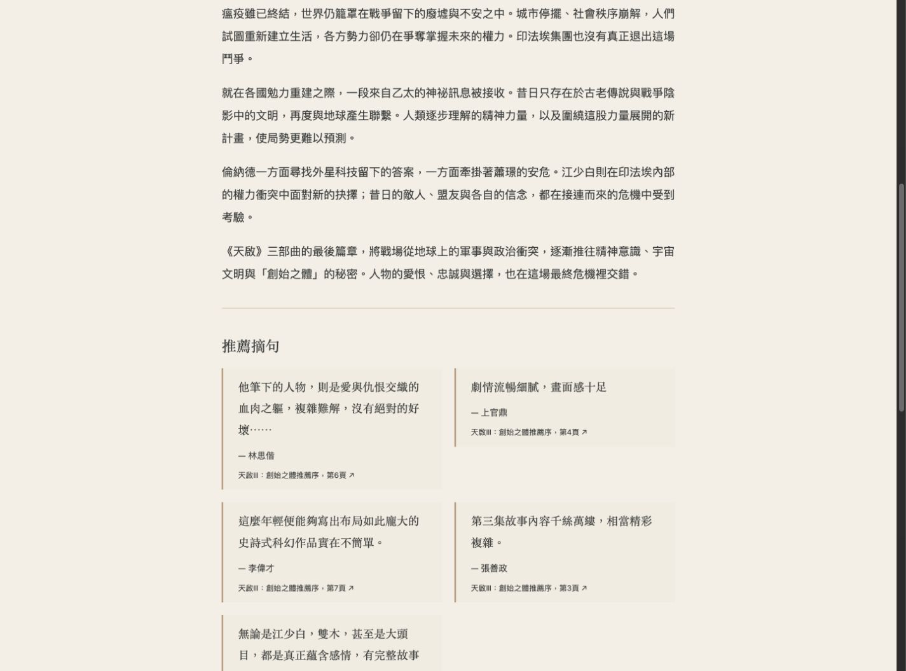|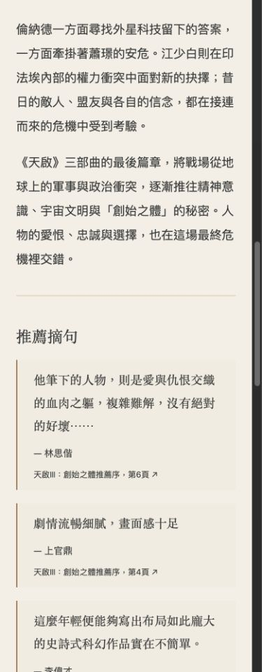|
|紙本、電子書與博客來分組|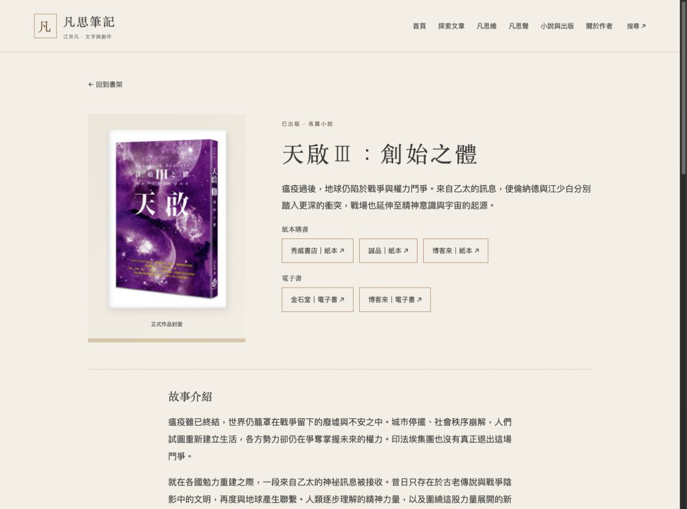|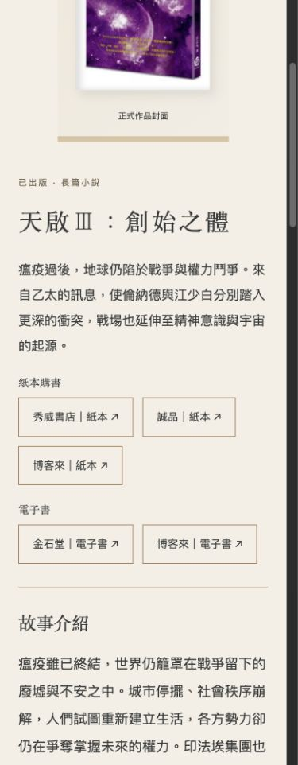|

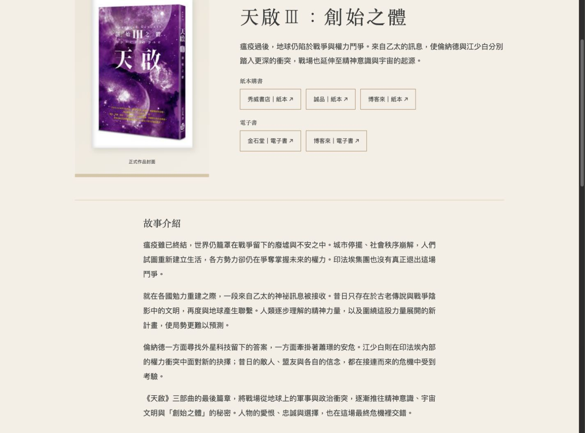

正式頁尾以DOM計算樣式及全域CSS／Main.astro零差異確認未受推薦元件影響；既有頁尾截圖保留於下方歷史驗收。

---

## 以下為2026-11-15首批歷史驗收

其中18入口、推薦折疊與博客來待補網址等描述及截圖為當時狀態；**已由上方2026-11-16紀錄取代，不作為現在待辦或介面規格**。保留原驗收證據，不重新執行已完成功能。

> **2026-11-16 作者補件＋頁面精修（PR #20 待作者重新驗收）**：本文件下方的「18筆入口／71項測試」是**前一版執行驗收快照**，不是最新資料總數。作者後續提供八個博客來單冊商品直達URL；已寫入`publications.json`、原始輸入與對應測試，總計**26筆平台入口**。七筆故事介紹已加長，推薦摘句來源已增加；下一步Codex仍需改推薦全部展開與署名卡片CSS、重跑CI、更新本文件最終驗收截圖。未合併、未部署。本次不宣稱新的UI排版已完成。

# M5-E 第一批主要展示驗收

2026-11-15｜PR #20 `prep/m5e-publication-display-20261115`。接續準備提交 `60c5fce22a5294a86490f9df91c20d72a1ac9068`，基底仍為 PR #19；不修改或合併 #19。

**主要展示已實作／本機測試通過／待作者驗收。** GitHub CI以本PR最新提交的「網站驗證」結果為準。沒有部署、解除noindex、匯入小說全文、啟用服務或進入M5-F。這不代表整個M5-E完成。

## 實際接入

- `publications.json`：七筆唯一作品，固定ID／slug、18筆原網址，六張遠端正式封面；沒有試讀、全文或虛構世界觀。原合成書籍及關聯移至 `tests/fixtures/`，不產生正式demo路由。
- `publications.mjs/ts`：完整段落、逐字推薦與來源、列名推薦、版本日期／ISBN、分組入口、display_order，以及網路發表與完結的獨立狀態；未知資訊不補造。僅數據風暴的指定HTTP原網址可例外，不能給別篇或其他HTTP網址。
- `Bookshelf`／`BookCover`／作品詳頁／`Endorsement`：沿用層板陰影、既有比例與配置；先短介及紙本／電子書／線上閱讀，再完整介紹、推薦、系列、版本及確實相關內容。推薦前兩則直接呈現，其餘原生details。智慧奇點上下冊清楚標示整部作品介紹與推薦。
- `author.json`／作者schema／作者頁／首頁／共用署名：同份核准長短介紹、年表、社群；照片完整640×960、本地base路徑，無裁切。首頁最新四篇排序及五場景未改。
- 正式出版關聯目前為空，`PublicationRelations`增補明確型別，使空關聯合法且不輸出空區塊。隔離建置仍驗證文章與出版雙向關聯、另行核准短篇全文。
- CI新增離線輸入檢查；保留原67項測試的保障，新增4項M5-E測試。舊「空書架」斷言改為正式作品存在且合成作品不存在；本機連結檢查只對指定HTTP網址及唯一作品路由放行，未廣泛降低URL安全要求。

## 七筆作品結果

|作品|順序／狀態|入口數|詳頁與封面|
|---|---|---:|---|
|天啟Ⅰ：末世訊號|天啟1、已出版|3|詳頁正常；秀威200×301原圖成功|
|天啟Ⅱ：始皇印記|天啟2、已出版|3|詳頁正常；秀威200×284原圖成功|
|天啟Ⅲ：創始之體|天啟3、已出版|3|詳頁正常；秀威200×301原圖成功|
|智慧奇點（上）|智慧奇點1、已核實電子書|4|詳頁正常；BOOK☆WALKER867×1240原圖成功|
|智慧奇點（下）|智慧奇點2、已核實電子書|3|詳頁正常；BOOK☆WALKER867×1240原圖成功|
|心靈倒影|網路發表・已完結|1|詳頁正常；鏡文學595×842原圖成功|
|數據風暴|公開短篇|1|詳頁正常；使用既有文字標籤，無假封面|

三部曲及上下冊雙向系列入口逐頁驗證。上下冊BOOK☆WALKER網址分開；KadoKado26481僅對應智慧奇點，標示整部作品；心靈倒影使用鏡文學32150。金石堂Readmoo通路保留金石堂標示，不冒稱讀墨官網。

## 圖片、外站與例外

六張封面在實際瀏覽器均 `complete=true` 且 `naturalWidth>0`，保留上述原比例、`object-fit:contain`、no-referrer；沒有下載檔案、搜尋替代素材或使用代理。失敗測試使用Repository外暫存頁，只有圖片URL替換為本機404：圖片隱藏、文字標籤出現、標題與三個購書入口仍在。測試頁未加入src或正式dist。

作者照片實際載入640×960，手機顯示240×360；麥克風與獎座、完整構圖保留。原檔SHA256通過輸入檢查與測試。

有限外站點擊驗收：秀威天啟Ⅰ可開啟且書名／作者吻合；BOOK☆WALKER221465可開啟、標題為智慧奇點（下）；數據風暴原HTTP網址可開啟，標題及標頭為「数据风暴」，未重新匯入全文。其餘18筆入口已逐筆與契約核對href及分組，**不宣稱全部外站已逐一實訪或永久可用**。

仍未達成的平台需求：博客來、讀墨官網各冊直達網址尚未全數核實；本輪未造按鈕、未廣泛搜尋，並未視為作者放棄。輸入JSON及PACKAGE_INDEX是準備時內容契約／指紋，保持原樣；其準備狀態不代表本輪UI現況，現況以CURRENT_STATE及此驗收為準。

## 保護與測試

- `python3 scripts/check_m5e_inputs.py`：PASS，7作品／18網址／6遠端封面／照片指紋及完整文案。
- `npm run check`：84檔，0 errors／0 warnings／0 hints。
- `npm run build`：114頁（原107頁＋7正式作品詳頁）。
- `npm test`：71/71 PASS，原67＋新增4；原48及新增9篇SHA256、原16及現25組配對、分類、人氣、圖片與分頁保障保留。
- 相對準備提交的Git差異：57篇文章、Podcast／映射／分類／人氣JSON、article-images.json與定位、五場景、文字卡、ArticleBrowser及分頁均零修改。原文雜湊基準未變；本輪沒有小說全文、私人提案、私人聯絡資料或未公開作品。
- 1440px／390px：書架、長篇、短篇、作者、首頁代表性實頁截圖；書架手機雙欄、詳頁上下堆疊。360px五類頁面無水平溢出，數值見 `narrow-viewport.json`。
- 鍵盤：長篇推薦summary按Enter可展開第三則；從返回書架按Tab可到購書入口，焦點框可見。狀態篩選online僅顯示心靈倒影／數據風暴；智慧奇點系列僅上下冊。
- reduced-motion：保留原書架媒體條件下 `transition:none!important`／`transform:none!important`，新增測試固定此保障；本輪無新增動態。瀏覽器工具未提供偏好模擬，未把此項冒稱作業系統偏好切換實測。

## 實際截圖

|版型|桌機1440px|手機390px|
|---|---|---|
|書架||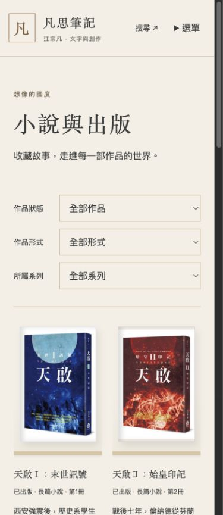|
|長篇詳頁|||
|公開短篇|||
|作者頁|||
|首頁正式內容|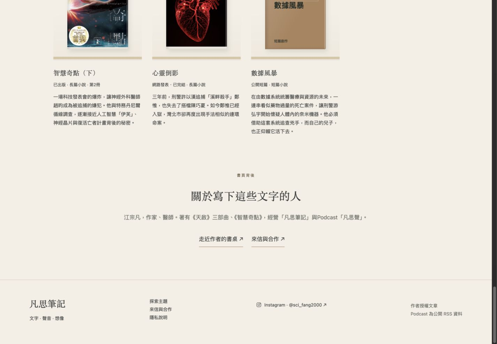|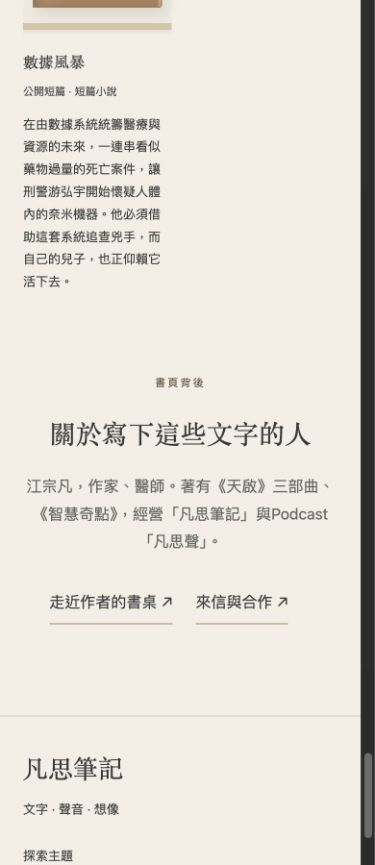|

下一批留言、私人聯絡與分析需另行決策與授權；M5-F全站驗收、M6正式部署分開。等待作者對主要展示驗收，不自動繼續。
