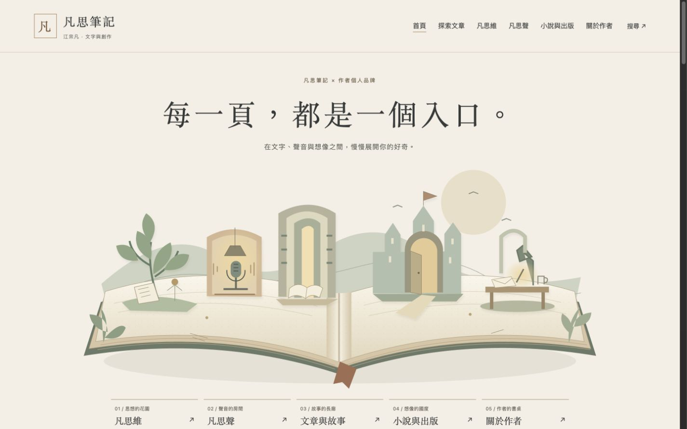
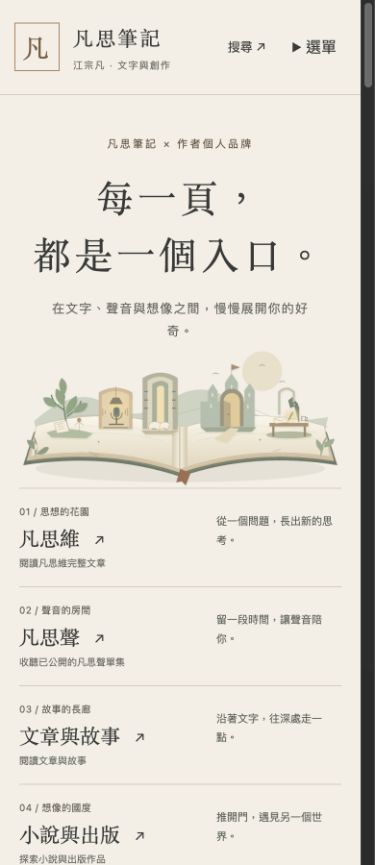
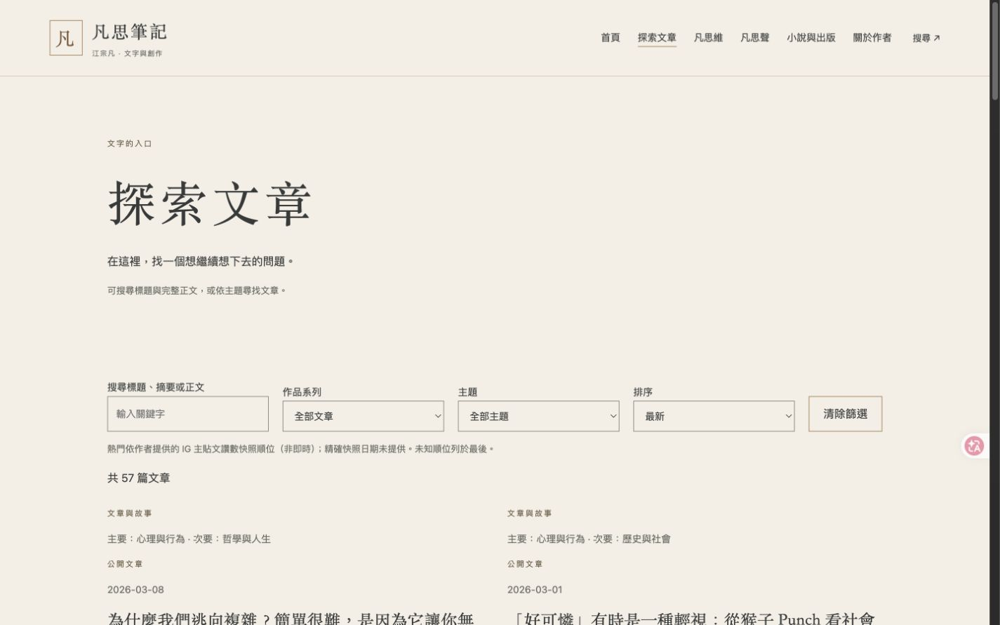
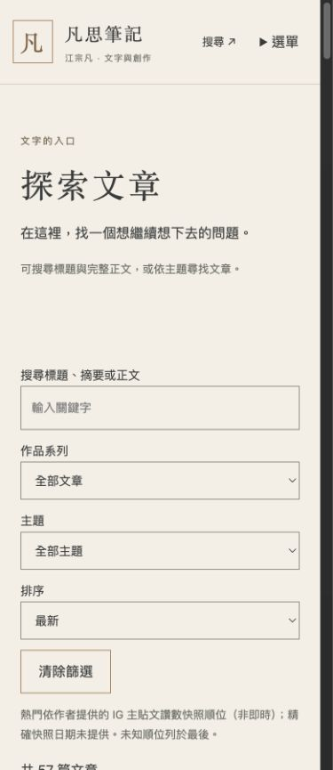
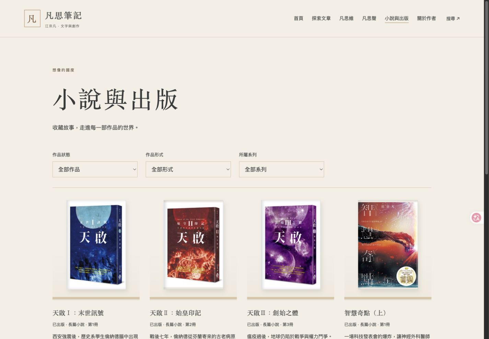
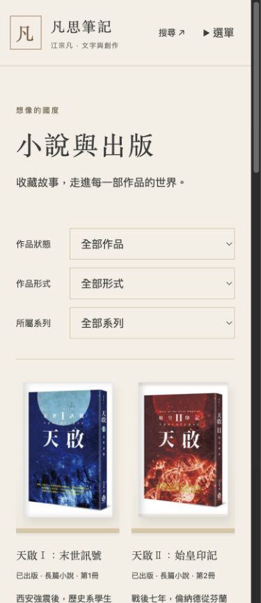
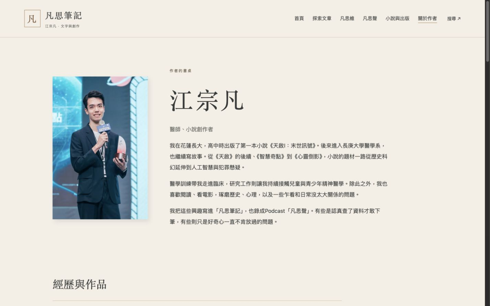

# M5-F 一次性全站整合驗收

2026-11-16。從PR #21文件收尾提交`21ec5d3`接續，分支`qa/m5f-final-acceptance`，base為`prep/m5e-free-interactions-20261116`。作者已接受M5-E操作／視覺，並確認短期Access設定Token撤銷，不重新選型或要求重建Token。

**工程與已執行整合檢查通過；仍有真實身分／跨瀏覽器安全待驗，不能宣稱可直接正式上線。** 沒有合併、正式部署、解除noindex、重寄來信或變更雲端政策。

## 問題與最小修復

首頁五場景仍含「正式書封與作品資料待提供」「公開署名與簡介待確認」及「尚未定版」提示，與已上架資料矛盾。僅修改Storybook的三個提示文字，沿用既有品牌文字；插畫、結構、CSS、字型與互動不變。增加回歸斷言防止舊提示返回。

新增只讀全站建置檢查與穩定討論串fixture，沒有重新匯入內容或修改任何正文／雜湊基準。

## 驗收矩陣

|範圍|結果|證據與邊界|
|---|---|---|
|正式內容與資料|通過|既有雜湊／結構測試；57文章、25集／25映射、96內文圖、7作品／26入口、作者3段／13事件／照片與人氣資料未改。|
|全站路由／資源／段落錨點|通過|`build-audit.json`：114頁、6834個本機引用，無缺檔或失效錨點；原有site.test繼續保護base路徑。|
|列表、搜尋與分頁|通過|真Chrome文章第3頁搜尋「反脆弱」找到跨頁4篇；Podcast第2頁搜尋找到3集。文章20／Podcast15／主題12，清除後回正確範圍。|
|固定分類與熱門|通過|凡思維8作品、故事49文章；心理主題23作品，清除保持psychology。文章1–56＋null最後；Podcast原有首7天同順位保留。最新／最早未用人氣代替日期。|
|作品去重與書音入口|通過|原有catalog與核准GUID回歸；真staging一筆M5-F合成留言，在Podcast發表、重整仍存在，文章載入相同非空留言ID集合。未建立新映射。|
|小說／作者／首頁|通過|七個正式詳頁實際開啟，六封面全部載入；8個博客來單冊URL保留。首頁最新四篇及作者共用資料由既有建置測試驗證；本輪不重寫介紹或推薦。|
|圖片位置與失敗處理|通過|既有151位置ledger／96接入、冪等及來源保留測試通過；本輪不逐張重抓或故意阻斷遠端。即時尺寸紀錄中lazy圖尚未載入不等於失效。六個書封最終實際載入見publication-browser.json。|
|桌機／手機換欄|通過|13類代表頁×360／390／768／1440px共52次DOM尺寸檢查無水平溢出；8張桌手機截圖人工檢視。七作品另以360px檢查。|
|無障礙基本檢查|通過|手機選單可操作、鍵盤焦點solid可見；223個img具alt。正文／卡片／推薦保留普通文字，未包整卡連結。主要文字對米色對比10.04、輔助文字4.88；不是WCAG完整認證。|
|減少動態|通過|真瀏覽器按鈕切換data-motion=off／aria-pressed=true；原系統偏好及觸控測試保留。未切換使用者作業系統偏好。|
|404及相容入口|通過|真瀏覽器無效路徑顯示「這一頁，還沒翻到。」；longform／special顯示文章與故事，books主題顯示書籍與文學；既有redirect輸出及內部目的地檢查通過。|
|留言、聯絡錯誤處理|通過|沿用M5-E真服務證據，補驗非空留言持久／書音共串。真SQL安全測試涵蓋自刪、回覆、限流、10則分批與定位；聯絡逾時／429／失敗由隔離provider驗證。Gmail已實收，不重寄。|
|非白名單真實帳號Access|阻擋|已引導作者用本人可控的另一帳號，在獨立環境登入私人管理書籤。尚無最終拒絕證據；只有沒收到OTP不足。解除：確認未授權身分無法取得管理頁或資料。不得放寬允許政策。|
|獨立瀏覽器的讀者所有權|阻擋|既有獨立HTTP錯誤憑證403、單瀏覽器自刪與真SQL均通過，但未完成第二瀏覽器實測。解除：同作者Access登入另一瀏覽器，未複製刪除憑證時無本人刪除權限。|
|公開輸出與私人設定|通過|普通build及CI artifact來源dist逐檔掃描，無實際管理origin／Email白名單／服務secret；原啟用留言＋注入舊管理URL隔離build測試保留。正式服務預設關閉。|
|分析隔離與隱私|通過|沿用測試GoatCounter實收／匿名控制台拒絕證據；本輪staging只用既有test設定，事件只固定路徑／作品ID。無正式統計或個資上傳。|
|新增內容與同步契約|通過|既有隔離建置fixture確認新文章、改名／分類／平台一次更新索引；RSS測試保留人工分類與GUID。新增fixture確認既有thread／alias穩定、新作品僅多一串，未留下正式測試文章。|
|SEO／OG／canonical／sitemap|通過|114頁結構與94 sitemap入口，路徑可解析；既有SEO測試保留。noindex刻意維持。OG既有占位素材屬M6分享素材設定，不在此輪另造。|
|正式網域、production與RSS發布|不適用（本輪未授權）|M6另行授權，不以尚未啟用列工程故障，也不提前執行。|

## 實際範圍與保留例外

- 本輪自動與瀏覽器檢查不等於每種裝置／讀屏器的完整認證；長留言與刪父留回覆沿用已接受的M5-E畫面與真SQL保障。
- 原有待審憑證在管理端刪除後，同瀏覽器仍可能留下「等待作者審核」的自刪提示；只對持有憑證者可見，不洩漏他人內容，也不授予刪除權限。列為非阻擋提示同步微調，未在本輪擴充新API或重做留言架構。
- 讀墨官網各冊直達等既有外站未決事項繼續保留，未宣稱作者取消；本輪沒有重搜外站，沒有因工具拒絕讀取刪除作者提供URL。
- 無圖片／無推薦／無平台的區塊依既有條件收合。圖片遠端可用性可能變動，映射完整性和失敗處理不等於所有96張每次均成功連線。
- 少量M5-F合成留言僅在既有staging；為跨瀏覽器安全補驗暫留，未提交留言正文或私人資料庫到GitHub。作者試寫內容未收進截圖。
- 作者已接受的間距、字級或風格偏好不再另拆改版。首頁三個過時提示屬資料狀態錯誤，已最小修復。

## 測試與畫面

輸入檢查、64討論串清冊、local服務預檢、保護資料比對通過；check 115檔零錯誤／警告／提示，114頁build。原91項保障完整保留，新增3項整合回歸。本輪完整94項測試全綠，CI結果見PR本輪HEAD。

`browser-layout.json`為逐頁尺寸觀測；其中image loaded是當時即時狀態，不能把懶載入的false當失效。`publication-browser.json`記錄七頁、六個封面最終載入與各冊入口。

|桌機1440px|手機390px|
|---|---|
|||
|||
|||
|||

最新修正本機預覽：`http://127.0.0.1:4345/fansi-notes/`。既有staging維持PR #21互動程式，沒有為文字提示修復重設雲端資源；私人管理書籤仍只私下保存。

## M6 前置清單（尚未執行或授權）

1. 先完成上述兩項安全補驗，再由作者確認M5-F。核對最新refs／CI後，另行授權依#19→#20→#21→本M5-F PR順序，以保留歷史的merge commit整合；每次重核base、diff與CI，不強制合併。
2. 確認正式網站URL／託管與production API／D1／Turnstile hostname／精確Access政策。staging與production資料庫及私密設定分離，不搬合成留言；沒有正式網址前不造值。
3. 備份Git版本與指定D1至repo外私人位置，演練恢復與回退。失敗先關閉單一服務開關、回退靜態建置及對應Worker版本；migration需單獨核對，不能以git回退取代資料復原。
4. 正式分析使用已存在的正式站點與正式hostname allowlist；確認私人控制台、事件無個資。接線驗收仍用test站，不把歷史測試事件搬進正式統計。
5. 經作者明確授權才解除noindex；同步canonical、OG／分享素材、sitemap、robots與404託管行為，確認base跨頁無舊環境跳轉。
6. 網站全文與素材只按作者核准的一筆work_id資料同步；後補Podcast／Vocus不重複作品。討論串清冊與必要alias遷移同環境同步，先備份後套用。RSS現有預覽artifact維持唯讀，真正自動發布需另授權。
7. 檢查免費額度、服務降級與通知／維護責任；不預設自動加值或付費升級，不新增大型後台。
